# Early Depression Detection from User Post Sequences (eRisk 2025 Task 2): System Design, Experiments and Findings

> **Scope.** The offline pipeline in `4Z03/jupyter` (data processing → feature engineering → sequence model → evaluation → ablations). The online client (`Test/`) has not been aligned with the new pipeline and is out of scope (Section 11).
> **Reporting convention.** Every result is the mean ± standard deviation over 3 random seeds (42, 43, 44) unless stated otherwise. Complete result tables are in Appendix A and are generated directly from the saved experiment results. Figures are generated by `docs/make_figures.py` from the same files.
> **Honesty note.** All numbers were produced by local runs. Anything that was not measured (for example computing cost) is explicitly marked as such.

---

## Contents

1. Summary and main findings
2. Task and data
3. System design and pipeline
4. Feature engineering
5. Sequence model and training
6. Evaluation protocol
7. Why the performance is lower than in the old README
8. Experiments and ablations
9. Feature selection and recommended configuration
10. Comparison with MentalRoBERTa (frozen and adapter fine-tuned), a bag-of-words baseline and repeated cross-validation
11. Limitations, risks and open work
12. Reproduction and code layout
- Appendix A. All experiment results
- Appendix B. Audit of the old pipeline

---

## 1. Summary and main findings

**System.** For each user, the posts (submissions and comments) are read in time order and a depression probability is produced after every post. A causal Transformer operates on a sequence of hand-designed, interpretable features. An alarm is raised once the probability stays at or above a threshold `th` for `k` consecutive posts.

**Main findings**

1. **PHQ-9 similarity features carry most of the signal and cannot be replaced.** Removing them lowers ROC-AUC from ≈0.95 to ≈0.89 and PR-AUC from ≈0.81 to ≈0.67. This holds in the full feature set, in the `lean` and `lean2` configurations, and on the parent-only subset.
2. **Most other feature groups are redundant.** Own-text LIWC categories (`liwc_HEALTH/ANX/SAD`) add a little; relative entropy (RE), cosine similarity (`sim`) and `post_index` can be removed without a measurable change; running means help when the feature set is small but can hurt with 150 features.
3. **LSM finding.** The original LSM was computed on raw LIWC *counts* instead of word *rates*, which mixes in a length effect. Recomputing it on rates and adding signed differences (LSMX) makes it much stronger when used alone, but most of that gain comes from the *parent text's own category rates* (topic/community selection), not from style matching. Without the parent rates, the remaining style-alignment features still give a small, fairly consistent gain on top of PHQ.
4. **(Superseded by item 8.) Recommended configuration on the single split: `lean2` (76 features)** = PHQ + RE + 3 own-LIWC categories + style-alignment LSM (rate-based LSM and signed difference) + running means; no `sim`, no parent rates. Full-data test PR-AUC 0.831 (second only to `lean_PHQ_plus_LSMX_no_par` at 0.834), ROC-AUC 0.950, OOF PR-AUC 0.744 (tied for best with `no_cummean`, 0.745), and no topic-shortcut features.
5. **The old README's F1 ≈ 0.93 is not comparable.** The old test set had control users truncated (longest 516 posts, while 57 % of depressed users had more than 600), which creates a length shortcut; the old features also had defects (unsorted history features, `-1` sentinels, in-sample RE). With the full data and an honest protocol, F1 is about 0.70.
6. **Comparison with MentalRoBERTa (same sequence model for all).** Against frozen embeddings, `lean2` ranks users better (ROC 0.950 vs 0.909, PR 0.831 vs 0.737) while the embeddings detect earlier (AUC@10 0.894 vs 0.860). Against an **adapter fine-tuned** MentalRoBERTa (cross-fitted logit), `lean2` is on par in PR (0.831 vs 0.814) and F1 (0.697 vs 0.688) but the fine-tuned model has the higher ROC (0.960) and the faster alarms (median 3.7 posts); combining both gives the highest test F1 (0.731) and PR (0.835) but not a higher OOF PR. **The system therefore does not clearly beat a fine-tuned MentalRoBERTa.**
7. **The largest uncertainty is sample size.** The test set has only 21 depressed users; the 95 % interval of the test F1 is about ±0.14–0.17 and seed noise is about ±0.03–0.05. Most F1 differences between configurations (0.66–0.72) cannot be resolved; conclusions should rest on PR/ROC/OOF metrics and consistent trends.

8. **Repeated cross-validation over all 891 users (Section 10.5) is the evidence to rely on, and it changes two conclusions.** (a) The single test split was optimistic (`lean2` PR 0.831 on the test set, 0.753 pooled; intervals about ±0.07). (b) There is no demonstrable gain from features beyond PHQ: `lean2`, `lean`, `only_PHQ` and `lean_PHQ_plus_LIWC` are indistinguishable (or `lean` is slightly better), so `lean2` is **not** supported as the recommended configuration (item 4 and Section 9 are superseded). The adapter fine-tuned MentalRoBERTa logit is the strongest method (ROC 0.963, PR 0.792, F1 0.788), significantly better than frozen embeddings and than a TF-IDF logistic-regression baseline, but not significantly better than the hand-crafted features after Holm correction. The bag-of-words baseline has the highest AUC@10 and the shortest delay.

9. **Error analysis (Section 10.6).** Most missed depressed users do disclose their depression, but in a few posts buried in long histories of unrelated comments; the sequence model does not keep such isolated evidence. About a third of the false alarms are control users who describe their own depression. A rule without training that alarms at the first self-reported diagnosis reaches F1 0.783 (best model 0.788) but alarms much later (median 55 posts), so the learned models' advantage is mainly earliness.

**Key numbers (full data, test set with 21 depressed users)**

| Configuration | # features | F1 | ROC | PR | AUC@10 | OOF PR |
|---|---|---|---|---|---|---|
| `lean2` (recommended) | 76 | 0.697±0.041 | 0.950 | 0.831 | 0.860 | 0.744 |
| `lean` | 44 | 0.708±0.023 | 0.947 | 0.820 | 0.868 | 0.716 |
| `only_PHQ` | 28 | 0.696±0.036 | 0.939 | 0.802 | 0.832 | 0.664 |
| `all` (all V2 features) | 150 | 0.664±0.045 | 0.948 | 0.806 | 0.857 | 0.726 |
| `post_level_only` (no history) | 43 | 0.614±0.049 | 0.915 | 0.698 | 0.871 | 0.613 |
| `mental_emb` (frozen MentalRoBERTa) | 771 | 0.666±0.034 | 0.909 | 0.737 | 0.894 | 0.629 |
| `ft_logit` (adapter fine-tuned MentalRoBERTa) | 4 | 0.688±0.019 | 0.960 | 0.814 | 0.888 | 0.735 |
| `ft_logit_plus_lean2` | 77 | 0.731±0.031 | 0.953 | 0.835 | 0.868 | 0.697 |

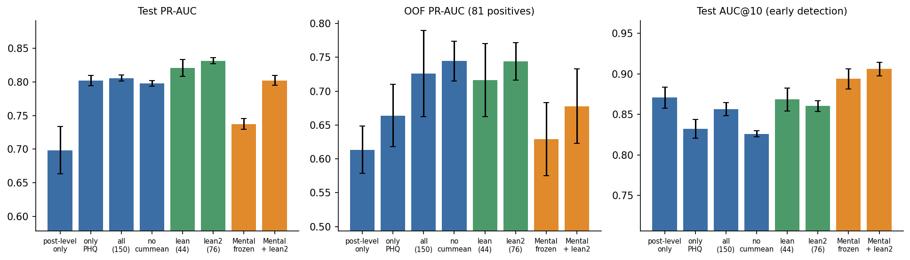

*Figure 1. Test PR-AUC, out-of-fold (OOF) PR-AUC and test AUC@10 of the main configurations (mean ± std over 3 seeds; y-axes are truncated). Blue: our feature sets, green: `lean`/`lean2`, orange: MentalRoBERTa-based.*

---

## 2. Task and data

### 2.1 Task
eRisk 2025 Task 2: early detection of depression risk for Reddit users. Each user has a time-ordered sequence of posts; the system must decide as early and as accurately as possible whether the user is depressed.

### 2.2 Data and cleaning
- Raw data: Reddit discussion threads (JSON) plus user-level labels. Only submissions and comments written by the target (labelled) users are kept, together with the text they reply to (the *parent text*).
- Cleaning rules: drop empty bodies, `[removed]` / `[deleted]`, posts without a label, with an invalid timestamp, and duplicates.
- After cleaning: **343,153 posts** (33,172 submissions, 309,981 comments). Dropped: 73,052 empty-body submissions and 2,987 `[removed]/[deleted]` posts.
- **Users:** 891 (18 control users disappeared because all of their posts were removed).
  - Train: 712 users (81 depressed), 278,540 posts.
  - Test: 179 users (21 depressed), 64,613 posts.
- **No truncation.** All posts are used and control users are not down-sampled (an important difference from the old pipeline, Section 7).
- **Parent text availability.** Only about 60 % of rows have parent text (`has_parent` ≈ 0.608 train / 0.578 test). `sim` and LSM have real values only on those rows.

### 2.3 User split
- A user-level 80/20 split (stratified by label, seed 42), frozen in `splits/user_split.csv` as an exact reproduction of the old assignment. The old and new test sets therefore contain **the same users** (183 before, 179 now; the difference is 4 control users whose posts were all removed).
- Inside the training users: 3 folds for cross-fitting the RE language models and 5 folds for classifier cross-validation (both user-level and stratified by label).

### 2.4 The "parent-only" subset
To study features that depend on parent text (LSM, `sim`), a subset was built that keeps only comments with a known parent text, and **all history features are recomputed on this subsequence**:
- Train: 169,421 rows, 689 users (81 depressed).
- Test: 37,345 rows, 171 users (21 depressed).
- Experiment names carry the prefix `parent_`.

---

## 3. System design and pipeline

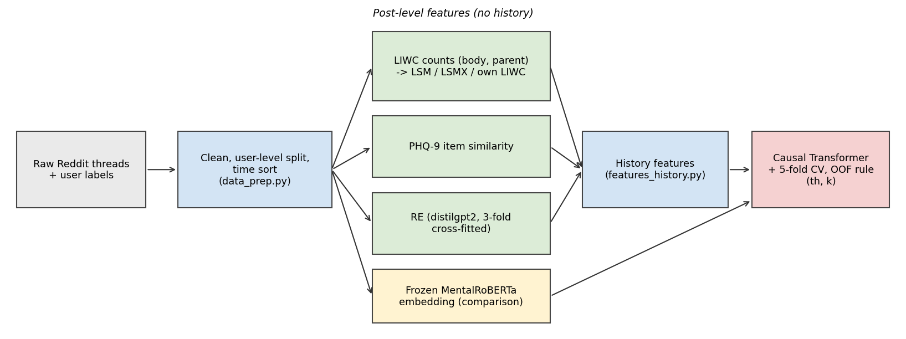

*Figure 2. Offline pipeline. Green boxes are post-level feature extractors, yellow is the optional frozen-embedding baseline.*

```
Raw JSON threads
  │  data_prep.py: read target posts + parent text, clean, user-level split, sort by time, row_id / re_fold
  ▼
Results/v2/{train,test}.csv
  │  post_features.py + external tools: post-level features (no history)
  │    ├─ LIWC category counts (body and parent)   -> liwc/, liwc_rates, lsm, lsmx
  │    ├─ PHQ-9 item similarities (extremism repo)  -> phq9
  │    ├─ RE (distilgpt2, 3-fold cross-fitted)      -> re
  │    └─ cosine similarity (MiniLM, comparison)    -> sim
  │  features_history.py: all history features in one place (max/min/gap/delta/rolling std/cummean/log_gap ...)
  ▼
Features/v2/{train,test}_features.pkl   (212 columns: V2 = 150 + LSMX = 62, besides 8 id columns)
  │  seq_model.py: standardise -> causal Transformer (probability at every post)
  │  experiment.py: 5-fold CV -> OOF probabilities -> decision rule (th, k) -> test once with the 5-model ensemble
  ▼
models/v2/classifier/<experiment>/   (results.json, probs.pkl, fold*.pt, scaler.json, oof_sweep.csv)
```

**Design principles**

1. **History features are computed in exactly one place** (`features_history.build_features`), so train, validation and test cannot disagree. Rows are sorted by (user, time) first and only past information is used. "Prefix invariance" is covered by tests: removing later posts does not change earlier features.
2. **Paths are managed in one place** (`paths.Paths`) and can be overridden with environment variables (`ERISK_THREADS_DIR`, `ERISK_LABELS_FILE`, `NLTK_DATA`); the notebooks contain no machine-specific paths.
3. **Thin notebooks.** `data-processing.ipynb` and `Develop/Train_and_evaluate.ipynb` only call module functions; training also runs from the command line (`run_experiments.py`) in the background.
4. **Cached experiments.** Each result is cached in `models/v2/classifier/<name>/`; a change of configuration or columns triggers retraining, otherwise the cache is reused.
5. **No sentinel values.** Rows without parent text get `sim`/LSM = 0, history values are carried forward from the user's last row that had a parent, and `is_comment` / `has_parent` tell the model which rows carry real values (the old pipeline used `-1`, which overlaps the valid range).

---

## 4. Feature engineering

### 4.1 Post-level features

| Group | Content | Source and notes |
|---|---|---|
| **PHQ** | 9 PHQ-9 item similarities, `phq_score` (mean of the 9) | Item scoring of the `extremism` repository (our fork), PHQ-9 archetype scale, applied to the post body; the sentence encoder is `mixedbread-ai/mxbai-embed-large-v1` (335 M parameters) |
| **RE** (relative entropy) | `loss_dep0`, `loss_dep1`, `re` | distilgpt2 fine-tuned separately on depressed and control posts; per-post mean token cross-entropy under both models; `re` is their difference. **3-fold cross-fitting:** training posts are scored by the fold model that never saw the user, test posts by the average of the 3 fold models |
| **SIM** | `sim` | MiniLM cosine similarity between a comment and its parent (rows with a parent only) |
| **LSM** (original) | 10 features: `LSM_mean`, `social_mean`, `positive_mean`, `negative_mean`, `first_person_singular`, `second_person`, `third_person_singular`, `third_person_plural`, `cognitive_process`, `perceptual_process` | Group mean of $1-\frac{\|a-b\|}{a+b+\epsilon}$ over LIWC categories, where *a*, *b* are the category **counts** of the comment and its parent (rows with a parent only) |
| **OWN_LIWC** | 15 category rates in the post's own text: `I, NEGEMO, POSEMO, SAD, ANX, ANGER, DEATH, FEEL, COGPROC, SOCIAL, HEALTH, BIO, FOCUSPAST, FOCUSFUTURE, NEGATE` | LIWC count ÷ word count |
| **BEHAVIOR** | `log_tokens` (log word count), `night` (posted 00:00–05:59 UTC), `log_gap` (log1p of seconds since the user's previous post, 0 for the first) | Behavioural signals |
| **CONTEXT** | `post_index` (log1p of the post number), `is_comment`, `has_parent` | Tell the model the row type and position |
| **LSMX** (new, 31) | `lsmr_*` (LSM on word rates, 10), `dlsm_*` (comment group rate − parent group rate, signed, 10), `par_*` (parent group rate, 10), `par_log_tokens` | Rows with a parent only; each feature has a raw value and a running mean |

### 4.2 History features
- **PHQ / RE / SIM / LSM:** current value, running maximum and minimum, their difference (`max_gap`), difference to the previous value (`delta`), rolling standard deviation over a window of 5. PHQ also has the running maximum of each item.
- **Running mean `*_cummean`:** mean up to the current position (for sim/LSM/LSMX computed over rows with a parent and carried forward).
- Feature counts: V2 has 150 (base 101 + OWN_LIWC 15 + BEHAVIOR 3 + running means 31); V3 has 212 (V2 + LSMX 31 + their running means 31).

### 4.3 Standardisation
`Standardizer`: z-score with statistics from the training rows only; `post_index` is log1p-transformed first; values are clipped to ±10 (without clipping the largest |z| reached 123, e.g. a one-word post with a LIWC rate of 1.0 would dominate a batch).

### 4.4 Signal strength of single features
User-level AUC = how well the per-user mean (or last running mean) of a feature separates depressed from control users (training users). AUC far below 0.5 means the signal is in the opposite direction.

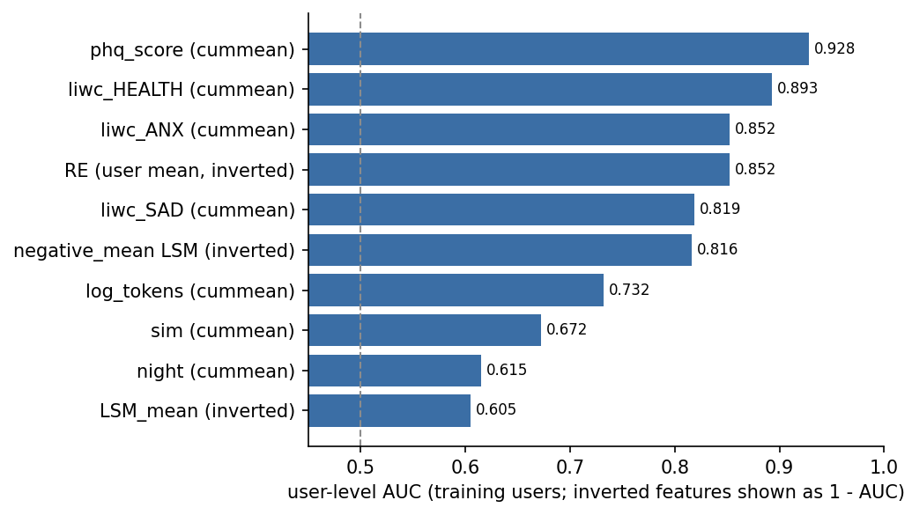

*Figure 3. User-level AUC of selected features on the training users (features with an inverted direction are shown as 1 − AUC).*

| Feature | User-level AUC |
|---|---|
| `phq_score_cummean` | 0.928 |
| `liwc_HEALTH_cummean` | 0.893 |
| `liwc_ANX_cummean` | 0.852 |
| RE (user mean, inverted) | 0.148 (inverted 0.852) |
| `liwc_SAD_cummean` | 0.819 |
| `negative_mean_cummean` (inverted) | 0.184 (inverted 0.816) |
| `log_tokens_cummean` | 0.732 |
| `sim_cummean` | 0.672 |
| `night_cummean` | 0.615 |

Rows with a parent only (training users):

| Feature | Post-level AUC | User-mean AUC |
|---|---|---|
| `phq_score` | 0.704 | 0.918 |
| `sim` | 0.536 | 0.659 |
| `LSM_mean` | 0.451 | 0.395 |
| `social_mean` | 0.399 | 0.210 |
| `negative_mean` | 0.376 | 0.153 |
| `perceptual_process` | 0.424 | 0.204 |
| `cognitive_process` | 0.417 | 0.250 |

Cohen's d on rows with a parent: `negative_mean` −0.438, `LSM_mean` −0.199, `first_person_singular` −0.150, `sim` +0.107. The aggregate `LSM_mean` and `sim` are weak; the signal sits in some LSM sub-scores. For the parent-rate features (LSMX) the user-level AUCs are `par_LSM_mean` 0.840, `par_negative_mean` 0.831, `par_first_person_singular` 0.824 and `par_log_tokens` 0.778.

---

## 5. Sequence model and training

### 5.1 Architecture
`UserSequenceModel` (`seq_model.py`):
- Linear projection of the inputs to 256 dimensions → 3 Transformer encoder layers (4 heads, dropout 0.3, PyTorch's default feed-forward width 2048, `batch_first`) → 2-layer MLP head (256→64→1) that outputs **one logit per position**.
- **Causal mask** (upper triangular): position *t* sees posts 0..*t* only, so the probability at *t* is exactly what could be known after reading *t*+1 posts. There is no truncation; users can have thousands of posts.
- No explicit positional encoding; order information comes from the causal mask and from features such as `post_index` and `log_gap`.
- About 4.0 M parameters (`lean2`: encoder 3.95 M + input projection 0.02 M + head 0.02 M; computed from the architecture, not measured).

### 5.2 Training details
- **Loss.** The user label is applied to every position of that user (binary cross-entropy), averaged over positions and then over users, so each user has the same weight regardless of the number of posts; `pos_weight` = (#negative users / #positive users) ≈ 7.8.
- **Optimisation.** AdamW, learning rate 3e-5, weight decay 0.01, gradient clipping 1.0, at most 30 epochs, early stopping with patience 5 on the validation loss of 12 % held-out training users, **restoring the best weights** (the old code did not copy the `state_dict`, a defect that is fixed).
- **Batching.** Length-bucketed; the number of users per batch and attention cells (users × longest length²) are capped.
- **Hyper-parameters** were chosen on a 16-configuration grid (`run_grid.py`) by OOF PR-AUC: learning rate 3e-5 beat 1e-4 (OOF PR 0.741 vs 0.715), 256×3 beat 128×2 (0.737 vs 0.718); dropout and the inner-validation fraction had almost no effect; the spread of PR across the grid (≈0.075) is comparable to the noise.
- **Non-determinism.** Re-running the same configuration changes F1 by up to 0.03 (for example 0.683 vs 0.714, caused by a single user crossing the threshold), therefore all conclusions use the mean ± std of 3 seeds.

### 5.3 Behaviour of the recommended model

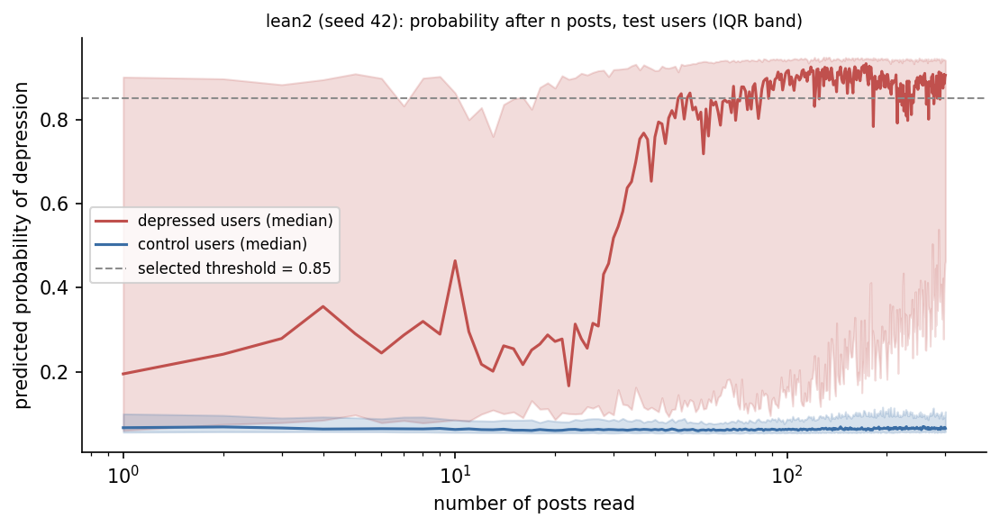

*Figure 4. `lean2` (seed 42): predicted probability after n posts for the test users (median and inter-quartile band, shown where at least 5 users have that many posts). The dashed line is the threshold selected on the OOF predictions.*

Control users stay at a low probability (median ≈ 0.07) whatever the number of posts, whereas for depressed users the median rises steeply after a few dozen posts and approaches the threshold. The wide inter-quartile band for depressed users shows that some of them are already above the threshold within the first posts while others need long histories.

---

## 6. Evaluation protocol

1. **User-level split.** The posts of a user are in exactly one of train or test; the RE cross-fitting and the CV folds are also user-level.
2. **Past information only.** History features are time-sorted and prefix-invariant (covered by tests).
3. **Cross-fitted RE.** The RE of a training user comes from fold models that never saw that user; test users use the mean of the 3 fold models, which avoids the "training RE is easier to separate than test RE" bias.
4. **Standardisation statistics come from training rows only.**
5. **5-fold CV.** One model per fold; the pooled OOF probabilities are used to choose the decision rule; the test set is **evaluated once**, with the average probabilities of the 5 fold models.
6. **Decision rule.** A user is flagged when the probability is ≥ `th` for `k` consecutive posts; (th, k) is chosen on the OOF predictions from th ∈ {0.05,…,0.95} and k ∈ {1, 3, 5, 10} to maximise the **latency-weighted F1 (F_latency)**.
   - F_latency = F1 × speed, where speed uses the eRisk latency penalty (constant 0.0078) computed from the median delay of correctly flagged users.
7. **Metrics**
   - User-level precision / recall / F1, median alarm delay (posts read before the alarm), F_latency.
   - **ROC / PR:** the highest probability a user ever reaches is used as the score.
   - **AUC@n:** user-level ROC-AUC of the probability after the first *n* posts (it does not reward simply having more posts). AUC@10 measures early detection, AUC@100 mid-term detection.
   - OOF PR-AUC (81 training positives) is more stable than the test metrics (21 positives) and is the more reliable basis for comparing configurations.
   - The test F1 comes with a 95 % bootstrap interval (1000 resamples of users).
8. **Known limitation.** Dozens of configurations were evaluated on the same test set (multiple-comparison problem). Conclusions therefore rely mainly on OOF metrics and on consistency across settings (full data / parent-only).

---

## 7. Why the performance is lower than in the old README

The old README reports F1 ≈ 0.93 for the final model (precision 0.91, recall 0.95, mean delay 6). On the same test users, the new pipeline gives F1 ≈ 0.70. The reasons:

### 7.1 The split did not change
The old and new test sets contain the same users (Section 2.3), so the new result is not caused by "an unlucky split". A single split with 21 positives has an F1 interval of ±0.14–0.17, but the gap between 0.93 and 0.70 (0.23) is far larger.

### 7.2 Control users were truncated in the old test set, creating a length shortcut (measured)
The old pipeline randomly removed posts of control users. Share of users with at least *n* posts in the old test table (`MERGED_test_full_fixed.pkl`, 183 users) and in the new one (179 users):

| Posts | Old test set (depressed / control) | New test set (depressed / control) |
|---|---|---|
| ≥ 100 | 86 % / 59 % | 86 % / 65 % |
| ≥ 300 | 62 % / 41 % | 71 % / 40 % |
| ≥ 600 | **57 % / 0 %** | 52 % / **26 %** |
| Longest control user | **516** | **1033** |

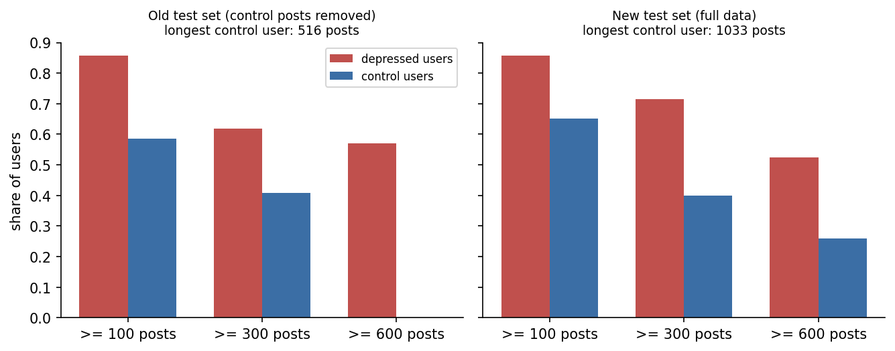

*Figure 5. Share of users with at least 100 / 300 / 600 posts in the old and the new test set.*

In the old test set no control user exceeded 516 posts, while more than half of the depressed users exceeded 600: a large `post_index` meant "depressed". With the full data, 26 % of control users also exceed 600 posts, the shortcut is gone and false alarms increase. This is the largest verified factor. The AUC of the *total* post count alone is similar in both sets (0.733 new vs 0.768 old), so the shortcut sits in the tail rather than in the overall volume.

### 7.3 Defects in the old features (details in Appendix B)
- History features were computed on data that was not time-sorted.
- About 92 % of rows had `min_sim_so_far == -1` (a sentinel that overlaps the valid cosine range).
- RE was computed in-sample (the language models were fine-tuned on the training posts and then scored the same posts).
- The baseline notebooks tuned thresholds on the test set (hard-coded 0.5701).
- No feature scaling (`post_index` can be in the thousands).

### 7.4 Stricter evaluation
The old version used a fixed threshold of 0.5, k = 5 and a single run; the new one chooses (th, k) on the OOF predictions (favouring early alarms) and reports the mean and std of 3 seeds.

### 7.5 Mislabelled old ablation
In the old ablation table, `cosine = 0.889` is actually the F1 of the PHQ-9 logistic regression with mean pooling; the cosine feature alone reached a Transformer F1 of only 0.588. Single features had F1 between 0.36 and 0.74 in the old README, yet the combination reached 0.93, which looks like a shortcut rather than a genuine synergy.

**Conclusion.** The old results are not a valid baseline. The new numbers (F1 ≈ 0.70, ROC ≈ 0.95) were obtained on the full data under a leak-free protocol and are more trustworthy.

---

## 8. Experiments and ablations

> Notation: F1, P, R are test-set user-level metrics; "OOF PR" is the out-of-fold PR-AUC of the training users; ROC/PR are AUCs of the highest probability a user reaches; AUC@10 is the AUC after the first 10 posts. Unless stated otherwise the data is "full data".

### 8.1 One group kept (`only_X`, plus the 3 context features)

| Experiment | # features | F1 | ROC | PR | AUC@10 | OOF PR |
|---|---|---|---|---|---|---|
| `only_PHQ` | 28 | 0.696±0.036 | 0.939 | 0.802 | 0.832 | 0.664 |
| `only_OWN_LIWC` | 33 | 0.687±0.033 | 0.904 | 0.725 | 0.815 | 0.631 |
| `only_LSM` (original) | 73 | 0.567±0.025 | 0.878 | 0.638 | 0.747 | 0.475 |
| `only_RE` | 12 | 0.561±0.019 | 0.876 | 0.531 | 0.838 | 0.478 |
| `only_BEHAVIOR` | 9 | 0.532±0.020 | 0.875 | 0.445 | 0.784 | 0.301 |
| `only_SIM` | 10 | 0.296±0.015 | 0.801 | 0.467 | 0.682 | 0.245 |
| `post_level_only` (no history) | 43 | 0.614±0.049 | 0.915 | 0.698 | 0.871 | 0.613 |

Observations:
- PHQ alone is almost as good as the full set (F1 0.696 vs 0.664–0.708).
- History features raise PR from 0.698 (no history) to about 0.81 but do not improve the early AUC (AUC@10 is even slightly lower): history helps mid- and long-term decisions.
- After fixing RE (removing a spurious 1/length factor and cross-fitting), `only_RE` improved from F1 0.368 to 0.561.
- `only_SIM` is essentially noise.

### 8.2 Leave one group out of the full set (`without_X`)

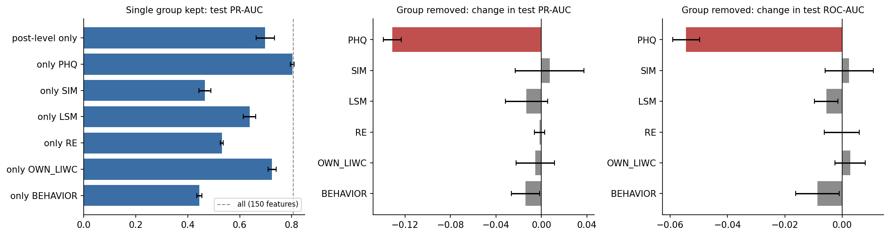

*Figure 6. Left: test PR-AUC when only one group is kept (dashed: all 150 features). Middle and right: change in test PR-AUC and ROC-AUC when one group is removed from the full set (paired by seed, mean ± std; red = clearly harmful to remove).*

| Experiment | F1 | ROC | PR | AUC@10 | OOF PR |
|---|---|---|---|---|---|
| `all` (150) | 0.664±0.045 | 0.948 | 0.806 | 0.857 | 0.726 |
| `without_PHQ` | **0.618±0.029** | **0.894** | **0.674** | 0.820 | 0.670 |
| `without_SIM` | 0.707±0.035 | 0.951 | 0.813 | 0.853 | 0.725 |
| `without_LSM` | 0.681±0.039 | 0.943 | 0.792 | 0.871 | 0.736 |
| `without_RE` | 0.686±0.007 | 0.948 | 0.804 | 0.848 | 0.723 |
| `without_OWN_LIWC` | 0.689±0.048 | 0.951 | 0.800 | 0.831 | 0.699 |
| `without_BEHAVIOR` | 0.692±0.024 | 0.940 | 0.792 | 0.837 | 0.705 |

**Only removing PHQ causes a clear drop; removing any other group leaves F1 slightly higher (+0.02 to +0.04, within noise) and ROC/PR essentially unchanged.**

### 8.3 Other controls (full data)

| Experiment | Description | F1 | ROC | PR | AUC@10 | OOF PR |
|---|---|---|---|---|---|---|
| `base_features` (101) | Old feature set, RE fixed | 0.685±0.042 | 0.951 | 0.800 | 0.824 | 0.737 |
| `no_cummean` (119) | Full set without running means | 0.702±0.031 | 0.949 | 0.798 | 0.826 | 0.745 |
| `all` (150) | | 0.664±0.045 | 0.948 | 0.806 | 0.857 | 0.726 |

Adding the new features (own LIWC, behaviour, running means, `log_gap`) did not improve the overall metrics; the F1 differences between the three rows are below seed noise. Running means show signs of over-fitting in the large set (`all` has a lower and noisier OOF PR than `no_cummean`) because the Transformer can already aggregate history.

**`log_gap` (time since the previous post).** Adding it raised the F1 of `only_BEHAVIOR` from 0.483 to 0.532 (precision 0.34 → 0.43), so the time gap carries some information; in the full model it is covered by PHQ and the other features and shows no visible improvement.

### 8.4 The `lean` configuration (44 features) and its ablations

`lean` = all PHQ features + 3 context features + RE (`re`, `re_cummean`) + 3 LIWC categories (`liwc_HEALTH/ANX/SAD`, each with a running mean) + 4 original LSM sub-scores (`negative_mean`, `perceptual_process`, `social_mean`, `first_person_singular`, each with a running mean). No `sim`.

Leave-one-part-out:

| Removed | # features | F1 | ROC | PR | AUC@10 | OOF PR |
|---|---|---|---|---|---|---|
| none (`lean`) | 44 | 0.708±0.023 | 0.947 | 0.820 | 0.868 | 0.716 |
| PHQ | 19 | **0.576±0.013** | **0.900** | **0.703** | 0.827 | 0.611 |
| all running means | 35 | 0.644±0.011 | 0.945 | 0.807 | 0.835 | 0.658 |
| LIWC (3) | 38 | 0.656±0.023 | 0.947 | 0.809 | 0.858 | 0.714 |
| LSM (4) | 36 | 0.723±0.012 | 0.945 | 0.815 | 0.860 | 0.675 |
| RE | 42 | 0.694±0.051 | 0.945 | 0.820 | 0.863 | 0.710 |
| `post_index` | 43 | 0.718±0.020 | 0.949 | 0.825 | 0.868 | 0.703 |

Adding one part to PHQ + context:

| Configuration | # features | F1 | ROC | PR | AUC@10 | OOF PR |
|---|---|---|---|---|---|---|
| `only_PHQ` | 28 | 0.696±0.036 | 0.939 | 0.802 | 0.832 | 0.664 |
| + RE (`lean_PHQ_plus_RE`) | 30 | 0.671±0.031 | 0.943 | 0.805 | 0.845 | 0.683 |
| + LIWC (`lean_PHQ_plus_LIWC`) | 34 | 0.708±0.028 | 0.947 | 0.820 | 0.864 | 0.707 |
| + LSM (`lean_PHQ_plus_LSM`) | 36 | 0.667±0.027 | 0.947 | 0.818 | 0.839 | 0.707 |

PHQ is the core; LIWC and running means contribute something real but small; RE and `post_index` contribute nothing; PHQ + 3 LIWC categories (34 features) matches the full `lean`.

### 8.5 LSM in detail

**Question 1: can LSM be made useful by projecting it to a higher dimension?** No. The model's first layer already projects the inputs linearly to 256 dimensions, so a manual up-projection is just another linear map and adds no information; the bottleneck is the signal and the sample size (81 training positives), not the dimensionality.

**Question 2: is LSM useful on rows that have a parent text only?** (`parent_*` experiments)

| Comparison | F1 | ROC | PR | AUC@10 | OOF PR |
|---|---|---|---|---|---|
| `parent_all` (with original LSM) | 0.655±0.043 | 0.950 | 0.788 | 0.868 | 0.703 |
| `parent_without_LSM` | 0.621±0.009 | 0.945 | 0.765 | 0.845 | 0.716 |
| `parent_lean` (with original LSM) | 0.623±0.020 | 0.950 | 0.791 | 0.874 | 0.678 |
| `parent_lean_without_LSM` | 0.622±0.008 | 0.941 | 0.768 | 0.858 | 0.682 |
| `parent_only_PHQ` | 0.636±0.040 | 0.934 | 0.760 | 0.835 | 0.712 |
| `parent_only_LSM` (alone) | 0.517±0.028 | 0.858 | 0.592 | 0.753 | 0.468 |

On data with a parent text the original LSM gives a small, fairly stable ranking gain (PR +0.02, AUC@10 +0.016 to +0.023); on the full data it does not.

**Question 3: the original LSM has a flaw.** The original formula is evaluated on raw LIWC **counts**, so a long post replying to a short one looks like a style mismatch: a length effect is mixed in. The new LSMX features use word rates and add signed differences and the parent's rates.

**LSMX results**

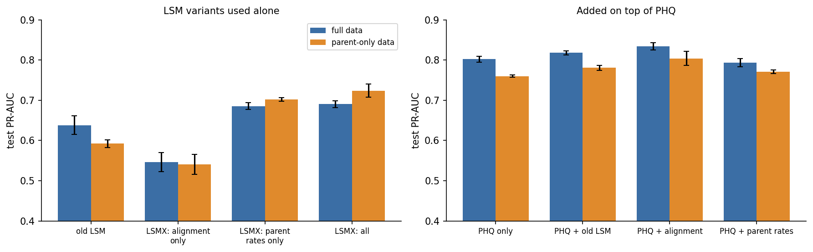

*Figure 7. Test PR-AUC of LSM variants used alone (left) and added on top of PHQ (right), on full data (blue) and on the parent-only data (orange).*

| Experiment | Data | F1 | ROC | PR | AUC@10 | OOF PR |
|---|---|---|---|---|---|---|
| `only_LSM` (original) | full | 0.567 | 0.878 | 0.638 | 0.747 | 0.475 |
| `only_LSMX` (all) | full | 0.584 | 0.910 | 0.690 | 0.825 | 0.558 |
| `only_LSMX_no_par` (lsmr + dlsm only) | full | 0.521 | 0.880 | 0.546 | 0.718 | 0.370 |
| `only_LSMX_par` (par_* only) | full | 0.620 | 0.889 | 0.685 | 0.832 | 0.586 |
| `parent_only_LSM` (original) | parent-only | 0.517 | 0.858 | 0.592 | 0.753 | 0.468 |
| `parent_only_LSMX` | parent-only | 0.607 | 0.917 | 0.724 | 0.790 | 0.572 |
| `parent_only_LSMX_no_par` | parent-only | 0.546 | 0.871 | 0.541 | 0.758 | 0.470 |
| `parent_only_LSMX_par` | parent-only | 0.597 | 0.892 | 0.702 | 0.817 | 0.578 |

Used alone, almost all of the LSMX gain comes from the parent rates (`par_*`), i.e. the content/topic of the posts the user replies to; the pure style-alignment part (`lsmr + dlsm`) is on its own even weaker than the original LSM (PR 0.546 vs 0.638).

**Added on top of PHQ the picture reverses:**

| Configuration | Data | F1 | ROC | PR | AUC@10 |
|---|---|---|---|---|---|
| `only_PHQ` | full | 0.696 | 0.939 | 0.802 | 0.832 |
| `lean_PHQ_plus_LSM` (original) | full | 0.667 | 0.947 | 0.818 | 0.839 |
| `lean_PHQ_plus_LSMX_no_par` (style alignment) | full | 0.687 | 0.949 | **0.834** | 0.857 |
| `lean_PHQ_plus_LSMX_par` (parent rates) | full | 0.684 | 0.944 | 0.793 | 0.856 |
| `parent_only_PHQ` | parent-only | 0.636 | 0.934 | 0.760 | 0.835 |
| `parent_lean_PHQ_plus_LSM` (original) | parent-only | 0.607 | 0.949 | 0.781 | 0.860 |
| `parent_lean_PHQ_plus_LSMX_no_par` | parent-only | 0.645 | **0.956** | **0.804** | **0.878** |
| `parent_lean_PHQ_plus_LSMX_par` | parent-only | 0.617 | 0.951 | 0.771 | 0.853 |

On top of PHQ the parent rates add nothing (their information is covered by PHQ: the topic of the parent text is correlated with the topic of the user's own text), whereas the style-alignment features give a small, consistent gain (PR +0.03 to +0.044) and are also better than the original LSM.

**LSM summary (suggested wording for a paper).** The count-based LSM mixes in a length effect. Recomputed on word rates with a signed difference added, it gives a small ranking gain on top of PHQ. The parent text's own rates are very strong alone but represent a topic/community effect covered by PHQ and should not be presented as "LSM is useful". The gains are small, the test set has 21 positives, so they should be described as trends.

### 8.6 `lean2` (recommended, 76 features)

`lean2` = all PHQ features + 3 context features + RE (2) + 3 LIWC categories with running means (6) + style-alignment LSM (`lsmr_*` and `dlsm_*`, 10 each, with running means: 40). No `sim`, no `par_*`, no behaviour features.

| Data | Configuration | F1 | ROC | PR | AUC@10 | OOF PR |
|---|---|---|---|---|---|---|
| full | `lean2` | 0.697±0.041 | 0.950 | **0.831** | 0.860 | **0.744** |
| full | `lean` | 0.708±0.023 | 0.947 | 0.820 | 0.868 | 0.716 |
| full | `lean_plus_LSMX` (106) | 0.715±0.017 | 0.951 | 0.822 | 0.870 | 0.718 |
| full | `lean_PHQ_plus_LSMX_no_par` (68) | 0.687±0.023 | 0.949 | 0.834 | 0.857 | 0.693 |
| parent-only | `parent_lean2` | 0.655±0.025 | 0.949 | 0.798 | 0.882 | 0.664 |
| parent-only | `parent_lean_plus_LSMX` (with par_*) | 0.665±0.031 | 0.961 | 0.815 | 0.873 | 0.684 |

Leave-one-part-out inside `lean2` (full data; parent-only in brackets):

| Removed | # features | ROC | PR | AUC@10 | OOF PR |
|---|---|---|---|---|---|
| none | 76 | 0.950 (0.949) | 0.831 (0.798) | 0.860 (0.882) | 0.744 (0.664) |
| PHQ | 51 | **0.887 (0.871)** | **0.632 (0.696)** | 0.823 (0.813) | 0.570 (0.553) |
| all running means | 51 | 0.942 (0.944) | 0.808 (0.755) | 0.837 (0.859) | 0.674 (0.671) |
| LIWC | 70 | 0.946 (0.956) | 0.810 (0.803) | 0.839 (0.870) | 0.693 (0.665) |
| LSM style alignment (all) | 36 | 0.945 (0.941) | 0.815 (0.768) | 0.860 (0.858) | 0.675 (0.682) |
| ... only `lsmr_*` | 56 | 0.950 (0.939) | 0.841 (0.789) | 0.865 (0.834) | 0.743 (0.672) |
| ... only `dlsm_*` | 56 | 0.952 (0.952) | 0.834 (0.791) | 0.861 (0.869) | 0.728 (0.709) |
| RE | 74 | 0.945 (0.949) | 0.820 (0.796) | 0.860 (0.876) | 0.748 (0.688) |
| `post_index` | 75 | 0.952 (0.955) | 0.835 (0.805) | 0.860 (0.872) | 0.730 (0.674) |

F1 on the full data when the part is removed: none 0.697; PHQ 0.527; RE 0.713; LIWC 0.686; LSM alignment 0.723; `lsmr` 0.714; `dlsm` 0.733; running means 0.707; `post_index` 0.715.

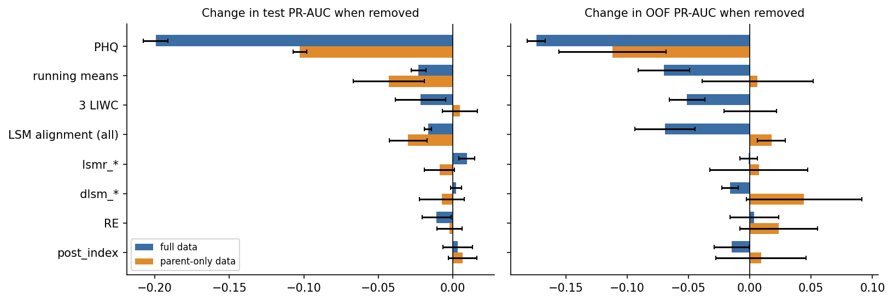

*Figure 8. Change in test PR-AUC (left) and OOF PR-AUC (right) when one part of `lean2` is removed (paired by seed, mean ± std; blue: full data, orange: parent-only data).*

Conclusions:
- **PHQ.** Removing it lowers every metric and is the only large drop, in both settings.
- **Running means** are second in importance (PR −0.02 to −0.04; OOF PR −0.07 on full data).
- **LSM style alignment** gives a small gain in test PR in both settings (−0.016 on full data and −0.030 on parent-only data when removed) and in OOF PR on the full data (−0.069), but not in OOF PR on the parent-only data (+0.018 when removed). `lsmr` matters more on parent-only data (AUC@10 −0.048, ROC −0.01); `dlsm` has little independent contribution.
- **LIWC** helps a little on the full data and hardly on the parent-only data.
- **RE and `post_index`** are redundant in `lean2` (their removal does not hurt any OOF PR); the fact that `post_index` is unnecessary also shows that the length shortcut has little influence on the current model.
- Only PHQ exceeds the noise by a wide margin (seed std of PR is about 0.01); everything else is a trend.

#### 8.6.1 Correlation of the `lean2` features with the label

Pearson r between each of the 76 `lean2` features and the depression label, computed on the 712 training users only (81 positives; the test set is not used), in three views: **post-level** (every post is a sample carrying its user's label; `lsmr_*` and `dlsm_*` only over rows with a parent), **user-level, all posts** (per-user mean of the feature; for running means and "so far" features the last value), and **user-level, first 10 posts** (the same on the first 10 posts, the setting that matters for early detection). Features are grouped by type. The values are also in `docs/figures/lean2_label_correlation.csv`.

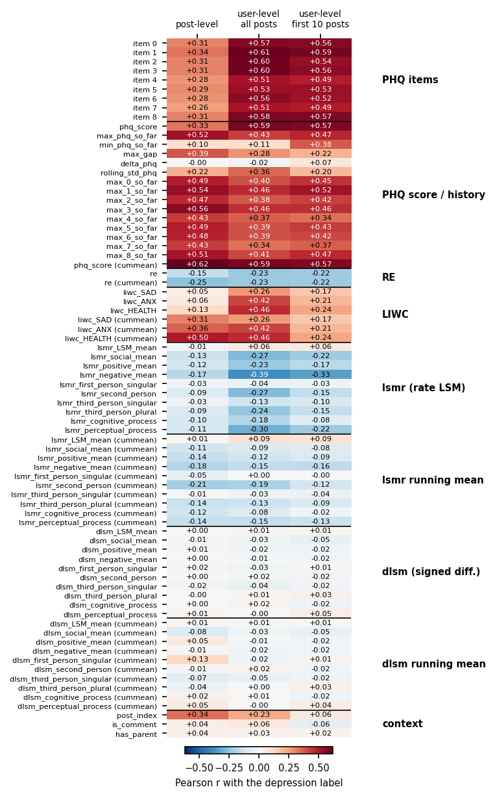

*Figure 8a. Pearson r between each `lean2` feature and the user label (training users).*

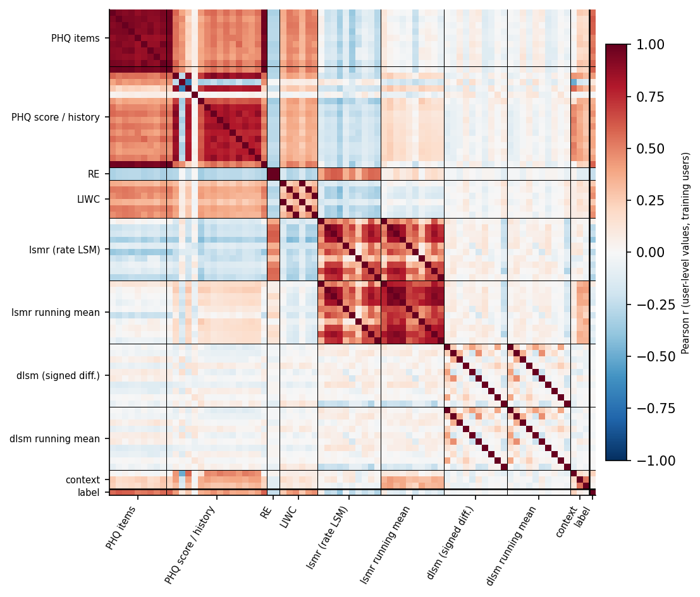

*Figure 8b. Correlation between the user-level feature values (all posts), ordered by type, with the label as the last row and column.*

- **PHQ** is the strongest type: the nine item similarities and `phq_score` reach user-level r = 0.51–0.61 (0.49–0.59 on the first 10 posts). The "so far" maxima and `phq_score_cummean` carry the signal at post level (r up to 0.62), because the history accumulates it; `delta_phq` is uncorrelated (−0.02).
- **LIWC** is the second type: `liwc_HEALTH` 0.46, `liwc_ANX` 0.42, `liwc_SAD` 0.26 over all posts, but only 0.24, 0.21 and 0.17 on the first 10 posts, so it needs more history than PHQ.
- **RE** is weakly negative (−0.23, equal in the first 10 posts); the sign is the direction of the inverted AUC in Section 4.4.
- **`lsmr_*`** is negative for the emotional and pronoun sub-scores: `negative_mean` −0.39 (−0.33 on the first 10 posts), `perceptual_process` −0.30, `social_mean` and `second_person` −0.27. Their running means are weaker (|r| ≤ 0.21 at post level, ≤ 0.19 at user level). `LSM_mean` and `first_person_singular` are close to 0.
- **`dlsm_*`** is uncorrelated with the label (|r| ≤ 0.05 at user level, ≤ 0.13 at post level), which agrees with its small independent contribution in the ablation above.
- **Context:** `post_index` has r = 0.34 at post level and 0.23 at user level, i.e. depressed users have longer histories (the length shortcut of Section 7); it is nearly 0 within the first 10 posts (0.06), and removing it did not hurt `lean2` (Section 8.6).
- **Redundancy (Figure 8b).** The nine PHQ items and `phq_score` correlate strongly with each other, and the PHQ items are positively correlated with LIWC (r 0.30–0.54, median 0.47) and mostly negatively with `lsmr_*` (−0.38 to 0.05, median −0.15). RE correlates positively with `lsmr_*` (0.28–0.60, median 0.53). The label's correlation with `lsmr_*` therefore partly reflects what PHQ and RE already measure, which fits the ablation result that these parts add little beyond PHQ.

Caveat: these are marginal linear correlations on 81 positive users and say nothing about interactions or about what the sequence model uses; the ablations remain the evidence for importance.

### 8.7 All features plus LSMX (`all_v3`, 212 features)
`all_v3` reaches F1 0.696±0.038, ROC 0.944, PR 0.798, no different from `all` (0.664, 0.948, 0.806); on the parent-only data it is worse (F1 0.655 → 0.621, PR 0.788 → 0.770). Too many features over-fit, which supports using a compact configuration.

---

## 9. Feature selection and the recommended configuration

Selection evidence: (1) single-group and leave-one-group-out experiments (8.1, 8.2); (2) ablations inside `lean` and `lean2` (8.4, 8.6); (3) user-level single-feature AUC (4.4, computed on the training users and therefore independent of the test labels); (4) consistency across the full data and the parent-only data; (5) only 81 training positives, which favours fewer and interpretable features.

**Kept:** all PHQ features (core), 3 own-LIWC categories (`liwc_HEALTH`, `liwc_ANX`, `liwc_SAD`), style-alignment LSM (`lsmr_*`, `dlsm_*`), running means, context features, RE (can be dropped when cost matters).

**Dropped:** `sim` (noise), parent rates `par_*` (topic shortcut, covered by PHQ), the other LIWC categories, behaviour features (`log_tokens`, `night`, `log_gap`; possible posting-volume bias), and most history features of the count-based LSM.

| Role | Configuration | # features | Rationale |
|---|---|---|---|
| **Main** | `lean2` | 76 | Full-data PR 0.831, OOF PR 0.744 (tied for best with `no_cummean`), no topic shortcut, interpretable features |
| Reference (compact) | `lean` | 44 | Close to `lean2`, simpler |
| Reference (minimal) | PHQ + 3 LIWC (`lean_PHQ_plus_LIWC`) | 34 | Matches `lean` |
| Baselines | `only_PHQ`, `post_level_only`, `all` | 28 / 43 / 150 | Show the value of each part |

A further simplification that has **not been run**: `lean3` = PHQ + 3 LIWC + `lsmr_*` + running means, without RE, `dlsm_*` and `post_index` (about 55 features).

**Update after the repeated cross-validation (Section 10.5).** `lean2` has no demonstrable advantage over `lean`, `only_PHQ` and `lean_PHQ_plus_LIWC`; the table above reflects the single-split choice and should be read together with Section 10.5, which recommends `only_PHQ` or `lean_PHQ_plus_LIWC` as the simplest hand-crafted configuration.

**Caveat.** F1 differences between configurations in the 0.66–0.72 range cannot be resolved; the choice of a configuration should not be based on test F1 alone.

---

## 10. Comparison with MentalRoBERTa (frozen and adapter fine-tuned), a bag-of-words baseline and repeated cross-validation

Two ways of using MentalRoBERTa are compared with our feature sets, **always with exactly the same sequence model, 5-fold CV, OOF decision rule and single test evaluation as every other experiment**, so that only the input features differ.

### 10.1 Setup
**Frozen embeddings.** `embed_posts.py` encodes every post body with `mental/mental-roberta-base` (at most 256 tokens, masked mean pooling of the last layer → 768 dimensions, float16, `Features/v2/{train,test}_mental_emb.npy`, aligned by `row_id`).
- `mental_emb`: 768-dimensional embedding + the 3 context features (771 inputs).
- `mental_plus_lean2`: embedding + the 76 `lean2` features (844 inputs).

**Adapter fine-tuned.** `finetune_mental.py` trains a bottleneck adapter (`seq_bn`, AdapterHub `adapters`) and a classification head on top of the frozen encoder.
- Post-level training: every post receives the label of its user; at most 200 random posts per user and epoch; positive class weighted by the class ratio; AdamW, learning rate 3e-4, batch 32, 3 epochs, maximum length 256, bf16 autocast; the best epoch is chosen on 10 % of the training users (48 users).
- **Cross-fitting to avoid leakage** (the same design as the RE feature): the 3 user-level folds of the RE feature are reused; each fold model is trained on the users of the other two folds and scores the users of its own fold; test posts get the mean logit of the 3 fold models. The result is one post-level feature `ft_logit` (logit of "depressed" minus logit of "control").
- Trainable parameters: 2.13 M (1.7 % of the 126.8 M of the model). Training took about 2–3 minutes per fold on one RTX 4090 (about 39 s per epoch when the GPU was not shared, 59 s when two folds shared it), peak GPU memory 3.4 GB.
- Two experiments: `ft_logit` (the logit + the 3 context features, 4 inputs) and `ft_logit_plus_lean2` (the logit + the 76 `lean2` features, 77 inputs).
- The user-level AUC of the simple mean of `ft_logit` over a user's posts is 0.932 on the training users (out-of-fold) and 0.897 on the test users.

### 10.2 Results (full data, test set, 3 seeds of the sequence model)

| Configuration | F1 | P | R | ROC | PR | AUC@10 | AUC@100 | Median delay | F_latency | OOF PR |
|---|---|---|---|---|---|---|---|---|---|---|
| `ft_logit` (adapter fine-tuned) | 0.688±0.019 | 0.740 | 0.651 | **0.960** | 0.814 | 0.888 | **0.930** | **3.7** | **0.681** | 0.735 |
| `ft_logit_plus_lean2` | **0.731±0.031** | 0.750 | 0.714 | 0.953 | **0.835** | 0.868 | 0.901 | 18.5 | **0.681** | 0.697 |
| `mental_emb` (frozen embedding) | 0.666±0.034 | 0.748 | 0.603 | 0.909 | 0.737 | **0.894** | 0.883 | 8.3 | 0.647 | 0.629 |
| `mental_plus_lean2` | 0.690±0.029 | 0.729 | 0.667 | 0.948 | 0.802 | **0.906** | 0.898 | 6.8 | 0.675 | 0.678 |
| `lean2` | 0.697±0.041 | 0.698 | 0.698 | 0.950 | 0.831 | 0.860 | 0.893 | 18.7 | 0.649 | **0.744** |
| `lean` | 0.708±0.023 | 0.687 | 0.730 | 0.947 | 0.820 | 0.868 | 0.893 | 17.7 | 0.661 | 0.716 |
| `only_PHQ` | 0.696±0.036 | 0.782 | 0.635 | 0.939 | 0.802 | 0.832 | 0.889 | 21.3 | 0.641 | 0.664 |

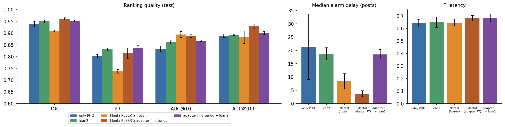

*Figure 9. Ranking quality (left), median alarm delay (middle) and F_latency (right) for `only_PHQ`, `lean2`, frozen MentalRoBERTa embeddings, the adapter fine-tuned logit and the fine-tuned logit combined with `lean2` (test set, mean ± std over 3 seeds of the sequence model; the adapter itself was trained once).*

### 10.3 Interpretation
- **Frozen embeddings vs our features.** `lean2` ranks users better overall (ROC 0.950 vs 0.909, PR 0.831 vs 0.737, OOF PR 0.744 vs 0.629). The frozen embedding detects earlier (AUC@10 0.894 vs 0.860, median delay 8 vs 19 posts).
- **Fine-tuning closes most of the gap to our features and goes beyond it in some respects.** One fine-tuned logit plus three context features reaches the highest ROC (0.960) and AUC@100 (0.930) of all configurations, alarms after a median of 3.7 posts, and is on par with `lean2` in PR (0.814 vs 0.831), F1 (0.688 vs 0.697) and OOF PR (0.735 vs 0.744); these last three differences are within noise.
- **Combining.** `ft_logit_plus_lean2` has the highest F1 (0.731) and PR (0.835) on the test set, but its OOF PR (0.697) is lower than that of `lean2` (0.744) and of `ft_logit` (0.735); with only 21 test positives the gain on the test set should not be trusted.
- On long histories the hand-crafted features are not inferior to a frozen 768-dimensional embedding (AUC@100 0.893 vs 0.883), but they are inferior to the fine-tuned logit (0.930).
- F1 values of all configurations lie between 0.67 and 0.73, with differences mostly below the noise.

**What can be claimed.** Our interpretable feature system does **not** clearly outperform a parameter-efficiently fine-tuned MentalRoBERTa: the two are on par in PR and F1, the fine-tuned model is better in ROC and in early detection, and combining them gives at most a small, unconfirmed gain. The defensible statements are that (i) interpretable features without any labelled fine-tuning reach a similar level, (ii) they clearly beat frozen embeddings in overall ranking, and (iii) the evaluation protocol is stricter than in earlier work.

**Limitations of this baseline.** The adapter was trained **once** (one seed), so the variance of the fine-tuning is not included in the ± values (they come from the sequence model only); its hyper-parameters were chosen once and not tuned; the best epoch was chosen on only 48 validation users; each fold model sees about two thirds of the training users, and the test logit is the mean of three models whereas the training logits come from a single model (the same design as RE); the design is post-level fine-tuning followed by a sequence model, and an end-to-end user-level fine-tuning was not tried.

### 10.4 Computing cost (measured)

Measured with `benchmark.py` (results in `docs/benchmark_results.json`) on one RTX 4090 and an Intel Xeon w5-2455X (24 cores visible), PyTorch 2.5.1 / CUDA 12.1. A fixed random sample of real test posts was used (mean 35 words, median 17). Times are per post at batch size 1 (the online setting), mean ± std over posts, after discarded warm-up calls and with GPU synchronisation; model loading is excluded. GPU memory is the peak above the memory allocated before the component was loaded.

| Component | Parameters | GPU fp32 (ms) | GPU fp16 (ms) | CPU 8 threads (ms) | CPU 1 thread (ms) | GPU memory fp32 (fp16) |
|---|---|---|---|---|---|---|
| LIWC (body + parent), CPU only | – | – | – | – | 1.14±1.33 (body only 0.68) | – |
| **PHQ-9 encoder (`mxbai-embed-large-v1`)** | **335 M** | 6.62±1.67 | 6.26±2.33 | 58.6±48.7 | 313.8±292.6 | 1.37 GB (0.68 GB) |
| Frozen MentalRoBERTa embedding | 125 M | 2.59±0.32 | 2.55±0.24 | 15.6±9.5 | 82.0±53.7 | 0.51 GB (0.26 GB) |
| RE: one pair of distilgpt2 models | 164 M | 3.61±0.45 | 3.65±1.91 | 28.9±17.5 | 148.3±106.6 | 0.79 GB (0.48 GB) |
| History features (full rebuild of a user, per post) | – | – | – | 2.38±6.61 (CPU, upper bound) | – | – |
| Sequence model, 10 posts of history | 4.0 M | 0.55±0.11 | – | 0.59±0.02 | 1.57±0.02 | 0.02 GB |
| Sequence model, 100 posts | 4.0 M | 0.51±0.01 | – | 1.70±0.06 | 5.87±0.10 | 0.02 GB |
| Sequence model, 1000 posts | 4.0 M | 1.04±0.00 | – | 19.99±0.25 | 113.89±1.05 | 0.08 GB |

The sequence model re-encodes the whole history for every new post (no KV cache), so its cost grows with the history length. At batch size 1 the GPU timings are dominated by kernel-launch overhead, which is why fp16 brings no gain there. The standard deviation on CPU is large because post lengths vary.

**Estimated total per post** (sum of the separately measured parts, history length 100, comment with parent text; *not* measured end to end):

| System | GPU fp32 | CPU 8 threads | CPU 1 thread |
|---|---|---|---|
| `lean2` without RE | ≈ 10.7 ms | ≈ 64 ms | ≈ 323 ms |
| `lean2` with RE (one model pair) | ≈ 14.3 ms | ≈ 93 ms | – |
| Frozen MentalRoBERTa + sequence model | ≈ 3.1 ms | ≈ 17 ms | ≈ 88 ms |
| MentalRoBERTa + `lean2` without RE | ≈ 13.2 ms | ≈ 79 ms | – |

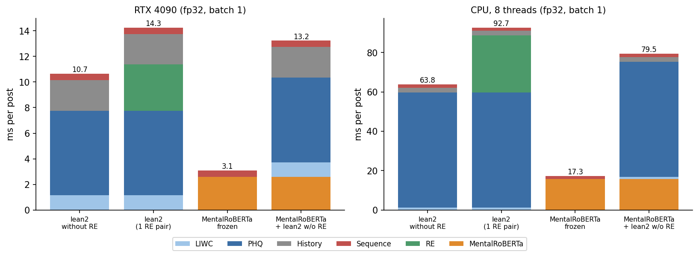

*Figure 10. Estimated per-post inference cost (ms) by component, GPU fp32 and 8 CPU threads, batch size 1.*

**Training cost (GPU fp32, one fold of about 500 users).** `lean2` without RE: 0.49 s per epoch including validation, peak GPU memory 1.96 GB; the saved 5-fold run used 47 epochs in total, i.e. about 0.4 minutes of pure training. `mental_emb` (771 inputs): 0.70 s per epoch, 87 epochs in total, about 1.0 minute, peak 2.0 GB. The wall time of a whole experiment including loading, the OOF sweep and the bootstrap was observed to be 1–4 minutes (not timed rigorously).

**What the measurements show**
- The classifier is tiny (4 M parameters, under a minute of training, about 0.5–1 ms per forward pass on GPU), and no large model is fine-tuned for the recommended `lean2` without RE: PHQ similarities are zero-shot and LIWC is a dictionary.
- **At inference, however, the recommended system is not cheaper than frozen MentalRoBERTa.** Its dominant cost is the PHQ-9 encoder `mxbai-embed-large-v1` (335 M parameters), which is 2.7 times larger than MentalRoBERTa-base (125 M) and 2.6 times slower per post on GPU (6.6 vs 2.6 ms) and 3.7 times slower on 8 CPU threads (58.6 vs 15.6 ms). In total the frozen MentalRoBERTa pipeline costs about 3 ms per post on GPU against about 11 ms for `lean2` without RE.
- **The adapter fine-tuned MentalRoBERTa baseline is cheaper than our system at inference:** it needs the 125 M-parameter encoder plus a small adapter (2.13 M parameters), so its per-post cost should be close to the frozen MentalRoBERTa (about 2.6 ms on GPU); the adapter overhead was not measured separately. Fine-tuning took about 2–3 minutes per fold (Section 10.1).
- RE adds about 3.6 ms per post per model pair on GPU (the offline pipeline averages 3 pairs); removing it does not change the metrics (Section 8.6), so it should be dropped.
- A smaller sentence encoder for the PHQ similarities would lower the cost, but it would change the PHQ features and has **not been evaluated**.
- **A claim of "computationally efficient" is supported only in this limited sense:** no task-specific training of a large model and a very small classifier. It is not supported as "cheaper than MentalRoBERTa" at inference.

**Caveats.** Single machine and single run of the benchmark; post lengths are short (median 17 words), so long posts cost more; batched throughput numbers with random, unsorted batches are dominated by padding and are not used here (they are kept in the JSON file); the offline feature extraction of the whole dataset and the fine-tuning of the RE models were not re-timed.

### 10.5 Repeated cross-validation over all users (the results to rely on)

**Protocol.** All 891 labelled users (102 depressed; train and test pooled) are split by 5-fold stratified cross-validation repeated 3 times (`cv_splits.py`, seed 2025). In every outer fold the sequence model is trained on about 80 % of the users exactly as in Section 5 (inner 5-fold CV, early stopping on 12 % of the inner training users); the decision rule `(th, k)` is chosen on the pooled inner out-of-fold probabilities of the training users only, and the 5 inner models are averaged on the held-out users (`cv_all.py`). Every user is therefore predicted once per repeat by a model that never saw it, and all configurations use identical splits and seeds.
- **RE is excluded** (`*_without_RE` names), because its language models are fitted on labels and would leak across the pooled folds; Section 8.6 shows that RE does not change the metrics.
- **`ft_logit` is re-fitted inside every outer fold** (`cv_ft.py`): 3 inner adapter models are trained on the outer training users only (one adapter run per outer fold).
- **`tfidf_lr`** (new bag-of-words baseline, `cv_tfidf.py`): TF-IDF (word 1–2-grams, minimum document frequency 5, at most 200 000 terms, sublinear tf; fitted on the outer training text without labels) and a logistic regression (`C = 1`) that scores every post with the label of its user (each user weighted equally, classes balanced). The user's score after *n* posts is the sigmoid of the running mean of the post logits, so it is causal and uses the same `(th, k)` rule, selected on the same inner out-of-fold scheme. `C` was compared among 0.1, 0.3, 1 and 3 on the inner out-of-fold F_latency of one outer fold only (0.710, 0.715, 0.732, 0.723); n-grams and vocabulary size were not tuned.
- **Metrics.** ROC and PR use the user's maximum probability; AUC@10 uses the probability after 10 posts; F1, median delay and F_latency use, for every user, the rule chosen in the user's own outer fold. Values are means over the 3 repeats; intervals are 95 % percentile intervals of a stratified bootstrap over users (2 000 draws, the same draws for every configuration, repeats averaged inside each draw). They reflect the finite number of users, not the training randomness.
- **Paired tests** (`cv_significance.py`) on the difference A − B: bootstrap p-value of the mean difference over repeats, adjusted by Holm's method within a pre-specified family of comparisons (family 1: 9 comparisons fixed before the analysis; family 2: 4 comparisons with the bag-of-words baseline, fixed before it was run, corrected separately so that family 1 is unaffected). The Nadeau–Bengio corrected resampled t-test on the folds, DeLong's test of ROC-AUC and McNemar's test of the alarm decisions are in `models/v2/cv_all/pairs.csv` and agree in direction.

| Configuration | ROC | PR | AUC@10 | F1 | F_latency | Median delay |
|---|---|---|---|---|---|---|
| `ft_logit` | 0.963 [0.947, 0.977] | 0.792 [0.732, 0.852] | 0.878 | 0.788 [0.735, 0.837] | 0.762 | 9.5 |
| `lean_without_RE` | 0.958 [0.942, 0.974] | 0.777 [0.710, 0.846] | 0.892 | 0.751 [0.695, 0.805] | 0.713 | 13.8 |
| `ft_logit_plus_lean2_without_RE` | 0.958 [0.940, 0.974] | 0.771 [0.709, 0.840] | 0.884 | 0.738 [0.685, 0.793] | 0.698 | 14.8 |
| `lean2_without_RE` | 0.953 [0.934, 0.970] | 0.753 [0.689, 0.822] | 0.883 | 0.723 [0.666, 0.782] | 0.680 | 16.3 |
| `lean_PHQ_plus_LIWC` | 0.952 [0.934, 0.968] | 0.749 [0.679, 0.820] | 0.891 | 0.732 [0.674, 0.790] | 0.706 | 10.3 |
| `only_PHQ` | 0.952 [0.935, 0.968] | 0.742 [0.677, 0.815] | 0.875 | 0.718 [0.657, 0.778] | 0.681 | 14.0 |
| `mental_plus_lean2_without_RE` | 0.957 [0.940, 0.971] | 0.741 [0.676, 0.812] | 0.879 | 0.719 [0.663, 0.774] | 0.702 | 7.2 |
| `mental_emb` | 0.938 [0.914, 0.960] | 0.726 [0.659, 0.798] | 0.889 | 0.729 [0.669, 0.786] | 0.708 | 8.3 |
| `tfidf_lr` | 0.914 [0.884, 0.940] | 0.680 [0.601, 0.759] | 0.902 | 0.715 [0.646, 0.775] | 0.702 | 5.7 |

*Table 10.5a. Pooled 5×3 cross-validation, 891 users (102 depressed), sorted by PR. Mean over repeats with 95 % bootstrap interval; AUC@10 intervals are about ±0.04.*

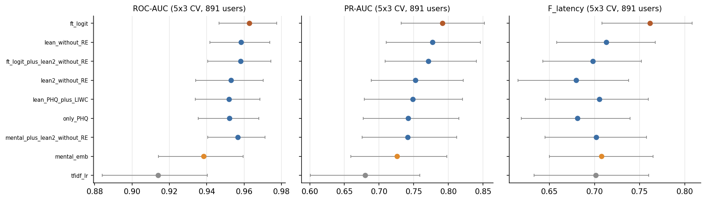

*Figure 11. Pooled 5×3 cross-validation: mean and 95 % bootstrap interval over users for ROC-AUC, PR-AUC and F_latency.*

| Family | A − B | ΔROC (Holm p) | ΔPR (Holm p) | ΔF1 (Holm p) | ΔAUC@10 (Holm p) |
|---|---|---|---|---|---|
| 1 | `lean2_without_RE` − `only_PHQ` | +0.001 [-0.006, +0.007] (1.000) | +0.010 [-0.025, +0.044] (1.000) | +0.005 [-0.027, +0.039] (1.000) | +0.008 [-0.010, +0.028] (1.000) |
| 1 | `lean2_without_RE` − `lean_PHQ_plus_LIWC` | +0.001 [-0.004, +0.007] (1.000) | +0.004 [-0.032, +0.040] (1.000) | -0.009 [-0.040, +0.022] (1.000) | -0.007 [-0.022, +0.007] (1.000) |
| 1 | `lean2_without_RE` − `lean_without_RE` | -0.005 [-0.009, -0.001] (0.042) | -0.025 [-0.048, -0.001] (0.322) | -0.028 [-0.051, -0.004] (0.182) | -0.009 [-0.021, +0.002] (1.000) |
| 1 | `lean2_without_RE` − `mental_emb` | +0.015 [+0.001, +0.031] (0.192) | +0.027 [-0.027, +0.083] (1.000) | -0.006 [-0.057, +0.047] (1.000) | -0.006 [-0.032, +0.022] (1.000) |
| 1 | `lean2_without_RE` − `ft_logit` | -0.010 [-0.019, -0.001] (0.192) | -0.039 [-0.086, +0.010] (0.810) | -0.065 [-0.113, -0.014] (0.088) | +0.005 [-0.025, +0.037] (1.000) |
| 1 | `ft_logit` − `mental_emb` | +0.024 [+0.011, +0.041] (0.004) | +0.065 [+0.019, +0.109] (0.045) | +0.059 [+0.023, +0.096] (0.018) | -0.011 [-0.034, +0.012] (1.000) |
| 1 | `ft_logit_plus_lean2_without_RE` − `ft_logit` | -0.005 [-0.013, +0.004] (1.000) | -0.020 [-0.064, +0.027] (1.000) | -0.050 [-0.095, -0.002] (0.270) | +0.006 [-0.022, +0.037] (1.000) |
| 1 | `ft_logit_plus_lean2_without_RE` − `lean2_without_RE` | +0.005 [+0.003, +0.008] (0.004) | +0.019 [+0.003, +0.036] (0.192) | +0.015 [-0.003, +0.036] (0.570) | +0.001 [-0.005, +0.007] (1.000) |
| 1 | `mental_plus_lean2_without_RE` − `lean2_without_RE` | +0.004 [-0.003, +0.010] (1.000) | -0.011 [-0.049, +0.028] (1.000) | -0.004 [-0.042, +0.032] (1.000) | -0.005 [-0.027, +0.016] (1.000) |
| 2 | `ft_logit` − `tfidf_lr` | +0.049 [+0.030, +0.071] (0.002) | +0.111 [+0.042, +0.180] (0.002) | +0.073 [+0.024, +0.125] (0.004) | -0.024 [-0.047, -0.003] (0.112) |
| 2 | `mental_emb` − `tfidf_lr` | +0.024 [+0.011, +0.039] (0.002) | +0.046 [-0.012, +0.109] (0.204) | +0.014 [-0.022, +0.054] (1.000) | -0.014 [-0.034, +0.005] (0.238) |
| 2 | `only_PHQ` − `tfidf_lr` | +0.038 [+0.018, +0.059] (0.002) | +0.062 [-0.014, +0.139] (0.204) | +0.003 [-0.061, +0.070] (1.000) | -0.028 [-0.058, -0.001] (0.144) |
| 2 | `lean2_without_RE` − `tfidf_lr` | +0.039 [+0.020, +0.060] (0.002) | +0.072 [+0.002, +0.144] (0.138) | +0.008 [-0.048, +0.075] (1.000) | -0.019 [-0.044, +0.005] (0.238) |

*Table 10.5b. Paired differences A − B (mean over repeats, 95 % bootstrap interval, Holm-adjusted p in parentheses).*

**What the cross-validation shows**
1. **The single test split was optimistic.** `lean2` reached test PR 0.831 and ROC 0.950 on the 21 test positives, against 0.753 and 0.953 pooled over all users (`lean2_without_RE`); the PR intervals are about ±0.07. Conclusions drawn from the test split alone were over-confident.
2. **Adapter fine-tuning is the strongest and the only clearly better method.** `ft_logit` has the highest ROC (0.963), PR (0.792), F1 (0.788) and F_latency (0.762). It is significantly better than frozen embeddings (ΔROC +0.024, ΔPR +0.065, ΔF1 +0.059; Holm p = 0.004, 0.045, 0.018) and than TF-IDF (ΔROC +0.049, ΔPR +0.111, ΔF1 +0.073; Holm p ≤ 0.004). Against `lean2_without_RE` it is better in ROC (+0.010), PR (+0.039) and F1 (+0.065) but not significantly after Holm correction (p = 0.19, 0.81, 0.088).
3. **Features beyond PHQ show no demonstrable gain.** `lean2_without_RE`, `only_PHQ` and `lean_PHQ_plus_LIWC` are indistinguishable (|ΔPR| ≤ 0.010, Holm p = 1). `lean_without_RE` is, if anything, slightly better than `lean2_without_RE` (ΔROC −0.005, Holm p = 0.042; ΔPR −0.025, p = 0.32). The style-alignment LSM features of Section 8.5–8.6 therefore do not help in the cross-validation; the single-split gain was within noise.
4. **Hand-crafted features add nothing to the fine-tuned logit.** `ft_logit_plus_lean2_without_RE` is not better than `ft_logit` (ΔPR −0.020, ΔF1 −0.050, not significant). It does beat `lean2_without_RE` in ROC (+0.005, Holm p = 0.004), which shows what the fine-tuned logit adds to the features, not the reverse. Adding frozen embeddings to `lean2` brings nothing (`mental_plus_lean2_without_RE`).
5. **Bag-of-words baseline.** TF-IDF logistic regression ranks users worse (ROC 0.914, PR 0.680; ROC significantly below every other configuration, Holm p ≤ 0.002) but has a similar F1 (0.715), the highest AUC@10 (0.902) and the shortest median alarm delay (5.7 posts). The differences to the PHQ-based configurations in PR, F1 and AUC@10 are not significant. The simple baseline is therefore competitive for early alarms, and a claim of early-detection superiority over a bag-of-words model is not supported. Its learned terms were not inspected for topic or community shortcuts.
6. **AUC@10** shows no significant difference between any two configurations (all Holm p ≥ 0.11).

**Revised recommendation.** If a hand-crafted configuration is wanted, `only_PHQ` or `lean_PHQ_plus_LIWC` (28 and 34 features) is as good as `lean2` and simpler; `lean2` is not supported as the recommended configuration. If the best accuracy is the aim, the adapter fine-tuned logit is the strongest option, at the price of a labelled fine-tuning step.

**Limitations of this analysis.** One sequence-model seed and one adapter run per outer fold; with 102 positives the intervals are wide (about ±0.07 in PR), so the non-significant differences are not evidence of equality; the comparisons were pre-specified but their number is still large; the `tfidf_lr` hyper-parameters were tuned lightly while the others were fixed earlier; the cross-validation uses the same users that earlier choices (feature groups, `lean2`, and the sequence-model hyper-parameters chosen with `run_grid.py` on the 712 training users) were made on, which favours those choices if anything; the decision rule is chosen on single-model out-of-fold probabilities but applied to the average of the 5 inner models (and, for `ft_logit`, to the average of 3 adapter models), so the threshold-based metrics (F1, delay, F_latency) may carry a small calibration shift, while ROC and PR are not affected.

### 10.6 Error analysis: false positives and false negatives

**Setup.** The pooled 5×3 cross-validation predictions of Section 10.5 are used, so every user is judged by models that never saw it. A user counts as an error of a configuration when its alarm decision is wrong in at least 2 of the 3 repeats. The main model is `ft_logit`; `lean2_without_RE`, `only_PHQ`, `mental_emb` and `tfidf_lr` are used for the overlap. Per-user descriptors come from the posts; two keyword patterns (regular expressions in `error_analysis.py`, fixed before the errors were inspected) mark posts with mental-health terms (depression, anxiety, therapy, antidepressants, suicide, …) and first-person self-reports of depression ("I was diagnosed with depression", "my depression", "I'm depressed", …). In addition, one reader went through the posts with the highest held-out `ft_logit`, the post at which a false alarm fired and the self-report posts of every error of `ft_logit`; there was no second annotator, so the categories below are indicative. Following the data-use agreement no text is quoted here; the excerpts stay local in `Results/v2/error_analysis/` (git-ignored).

| Configuration | FN (of 102) | FP (of 789) |
|---|---|---|
| `ft_logit` | 20 | 21 |
| `lean2_without_RE` | 24 | 34 |
| `only_PHQ` | 25 | 31 |
| `mental_emb` | 25 | 30 |
| `tfidf_lr` | 32 | 22 |

*Table 10.6a. Users misclassified by each configuration (majority over the 3 repeats).*

**Overlap.** Of the 41 depressed users missed by at least one of the five models, 9 are missed by all five; of the 56 control users flagged by at least one model, 7 are flagged by all five. Most errors are therefore model-specific, but a core of hard users is shared by every approach (Figure 12, left).

| Group | n | posts | words per post | share of posts with mental-health terms | users with a self-report phrase | mean held-out `ft_logit` | mean `phq_score` |
|---|---|---|---|---|---|---|---|
| TP | 82 | 464 | 35.0 | 0.155 | 87% | +0.93 | 0.446 |
| FN | 20 | 854 | 13.5 | 0.028 | 60% | -0.96 | 0.400 |
| TN | 768 | 208 | 13.5 | 0.000 | 2% | -1.73 | 0.375 |
| FP | 21 | 241 | 31.0 | 0.058 | 38% | +0.34 | 0.424 |
| p, FN vs TP | | 0.236 | <0.001 | <0.001 | 0.011 | <0.001 | <0.001 |
| p, FP vs TN | | 0.274 | <0.001 | <0.001 | <0.001 | <0.001 | <0.001 |

*Table 10.6b. Users grouped by the outcome of `ft_logit`: medians (share of users for the self-report column) and p-values (Mann–Whitney; Fisher's exact test for the self-report column; unadjusted, exploratory).*

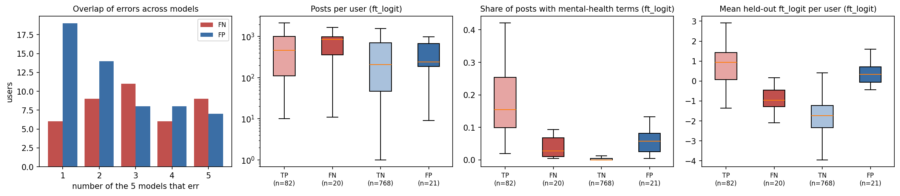

*Figure 12. Left: number of the five models that misclassify a user (users with at least one error). Right: posts per user, share of posts with mental-health terms and mean held-out `ft_logit`, by outcome of `ft_logit`.*

**False negatives (20 depressed users missed by `ft_logit`)**
- **The evidence is present but diluted.** In 17 of the 20 users the reader found at least one first-person statement of a depression diagnosis or of ongoing depression (the regular expression finds 12; it misses phrasings such as "I have chronic depression"). These posts receive high held-out `ft_logit`, so the post-level model recognises them. They are rare, however: a median 2.8 % of the posts contain mental-health terms (15.5 % for true positives), and the users have long histories (median 854 posts over about four years) of short, mostly unrelated comments (median 13.5 words against 35 for true positives).
- **The sequence model does not keep isolated strong evidence.** For 15 of the 20 users the peak probability never reaches the threshold (median peak / threshold 0.84), although single posts are scored as strongly depressive. The probability depends on the whole history and is pulled down by the many neutral posts.
- **Short histories.** Three users have only 11–32 posts; their probability crosses the threshold but not for `k` consecutive posts (near misses).
- **Other cases.** One user writes the disclosures partly in code-mixed English and Tagalog, which the English model scores low; two users show only indirect cues (discussing depression in general terms; therapy and passing sadness).
- **Possible remedies (not tested):** features that retain the strongest evidence so far (running maximum of `ft_logit`, number of posts above a score), or max/attention pooling over the history instead of a mean-like summary.

**False positives (21 control users flagged by `ft_logit`)**, categories from the manual reading (they overlap; each user is counted once, in the first matching category):
- **Own depression described in the first person** (diagnosis, ongoing depression, antidepressants for depression): 8. These cases cannot be resolved here: either the control label is wrong, or the collection's labelling criterion is stricter than what users write. Overall 27 of the 789 control users (3.4 %) match the self-report pattern in at least one post, against 83 of the 102 depressed users.
- **Other mental-health conditions or treatment** (bipolar disorder, complex PTSD, panic and anxiety, recovery groups): 4.
- **Chronic physical illness** with fatigue, pain or low mood (bowel disease, neuropathy, metabolic treatment): 3; two of them also mention feeling depressed.
- **Everyday distress** (loneliness, relationships, job dissatisfaction, family conflict): 4.
- **Supportive commenters** in mental-health communities who write about depression to others: 2.
- The false alarm usually fires on a neutral post (a thank-you, a short reply; median after 38 posts): it reflects the accumulated history, not the post itself. False positives have a higher mean held-out `ft_logit` than false negatives (+0.34 against −0.96), so at the user level many false positives look more depressive than the missed users, and no threshold can remove both error types.

**A rule without training as a sanity check.** Raising the alarm at the first post that matches the self-report pattern, with no learning at all, gives over all 891 users precision 0.755, recall 0.814 and **F1 0.783**, about the same as the best model (`ft_logit` 0.788); ranking users by the number of matching posts gives ROC 0.897 and PR 0.754 (`lean2_without_RE`: 0.953 and 0.753). The rule is late, however: median delay 55 posts, F_latency 0.621 (models 0.680–0.762) and AUC@10 0.578 (models 0.875–0.902).
- The labels are based on self-reported diagnoses, and such statements are still in the users' texts. Part of what any model learns is to recognise the labelling statement itself, and the F1 values of all methods should be read with that in mind.
- The added value of the learned models is mainly **earliness**: they flag users before an explicit disclosure appears.
- A paper should report this rule as a baseline and, if possible, an evaluation with the self-report statements removed.

**Caveats.** The keyword patterns are simple and not validated (both false matches and misses occur); the categories come from one reader; the counts depend on the majority rule over 3 repeats.

---

## 11. Limitations, risks and open work

**Limitations and risks**
1. **Few positives.** 81 training and 21 test depressed users. The 95 % interval of the test F1 is about ±0.14–0.17 and seed noise about ±0.03–0.05; a single user crossing the threshold changes F1 by about 0.03. Most F1 differences are not statistically significant.
2. **Many configurations were evaluated on the same test set** (multiple comparisons). OOF (81 positives) is more stable but is also a single split.
3. **Single split.** The main tables (Sections 1–9 and 10.1–10.4) use one train/test split. Section 10.5 repeats the key comparisons with 5×3 cross-validation over all 891 users; its results are the ones to rely on, and they are lower than the single-split test results.
4. **Topic/community shortcuts.** Parent-rate features (`par_*`) may reflect the community rather than the user's own state; they are excluded from the recommended configuration, but PHQ itself may also contain topic information.
5. **Posting-volume difference** between depressed and control users (median 508 vs 237 posts, training set) still leaves a partial shortcut for `post_index` and length-related features; the ablation shows that removing `post_index` does not change the metrics, which suggests a weak dependence but does not exclude it.
6. **External dependency.** The PHQ features depend on the `extremism` repository (our fork, branch `my-changes`, which contains the fix to `item_scoring.py`).
7. **The fine-tuned MentalRoBERTa baseline is a single adapter run** with untuned hyper-parameters and post-level training; its variance and the benefit of tuning or of end-to-end user-level fine-tuning are unknown.
8. **Repository hygiene.** The online client directory `Test/` contains a plaintext token (git-ignored but still in the git history; it must be cleaned before the repository is made public).

**Open work**
- More adapter seeds and some hyper-parameter tuning for the fine-tuned baseline, and possibly end-to-end user-level fine-tuning (the cross-validation of Section 10.5 uses one adapter run per outer fold).
- The `lean3` experiment (further simplification).
- Computing cost: measured in Section 10.4; not yet measured are the one-off offline extraction time of the whole dataset, the fine-tuning time of the RE models, and a smaller PHQ sentence encoder.
- Aligning the online client with the new pipeline (the old client uses the legacy 99-dimensional feature semantics).
- Rewriting the README (the existing one is outdated: it mentions `merge_data.ipynb`, `environment.yaml` and "Retrospective Encoder").
- Git commit, token and history clean-up; deleting `Archive/` (≈8.5 GB of old notebooks and results) once confirmed.

---

## 12. Reproduction and code layout

### 12.1 Environment
conda environment `hongyi` (Python 3.12); two RTX 4090 GPUs; main dependencies: pandas, numpy, torch, scikit-learn, transformers, sentence-transformers, the local LIWC (`liwc.py`, `liwc_script.py`, git-ignored).

### 12.2 Run order
```bash
# 1) Data and features (run the cells of data-processing.ipynb top to bottom, or call the module functions)
#    -> Results/v2/..., Features/v2/{train,test}_features.pkl (212 columns)

# 2) Frozen MentalRoBERTa embeddings (optional, for the comparison)
nohup conda run -n hongyi python -u embed_posts.py train --device cuda:0 > Results/v2/embed_train.log 2>&1 &
nohup conda run -n hongyi python -u embed_posts.py test  --device cuda:1 > Results/v2/embed_test.log 2>&1 &

# 2b) Adapter fine-tuned MentalRoBERTa: one process per user-level fold, then combine into the post-level feature ft_logit
for k in 0 1 2; do nohup conda run -n hongyi python -u finetune_mental.py fold --fold $k --device cuda:$((k % 2)) > Results/v2/ft_fold$k.log 2>&1 & done
conda run -n hongyi python finetune_mental.py combine

# 3) Training and evaluation (names are keys of feature_cols.EXPERIMENTS_V2; add --parent-only for the parent-only subset)
nohup conda run -n hongyi python -u run_experiments.py lean2 lean only_PHQ all --seeds 42 43 44 --device cuda:0 \
      > Results/v2/train.log 2>&1 &

# 4) Repeated cross-validation (Section 10.5): adapter per outer fold (15 jobs: --repeat 0..2, --outer 0..4), then the sequence models, the baseline and the tests
conda run -n hongyi python -u cv_ft.py --repeat 0 --outer 0 --device cuda:0
nohup conda run -n hongyi python -u cv_all.py --repeats 3 --shard 0 3 --device cuda:0 > Results/v2/cv_0.log 2>&1 &   # shards 0, 1, 2
nohup conda run -n hongyi python -u cv_tfidf.py --repeats 3 > Results/v2/cv_tfidf.log 2>&1 &
conda run -n hongyi python cv_significance.py --repeats 3   # -> models/v2/cv_all/{summary,pairs}.csv
conda run -n hongyi python error_analysis.py   # error analysis of Section 10.6

# 5) Summary: ex.seed_summary(P, [names], [42, 43, 44]) in Develop/Train_and_evaluate.ipynb
# 6) Figures: conda run -n hongyi python docs/make_figures.py
```
Seed 42 keeps the plain experiment name; other seeds are stored as `<name>_seed<seed>`.

### 12.3 Code layout (`4Z03/jupyter`)

| File | Purpose |
|---|---|
| `paths.py` | All paths and environment-variable overrides |
| `data_prep.py` | Reading threads, cleaning, frozen user split, time sorting, RE folds |
| `post_features.py` | LIWC/LSM/LSMX, own LIWC rates, cosine, RE (fine-tuning, scoring, cross-fitting), feature assembly |
| `features_history.py` | All history features (single entry point `build_features`) |
| `feature_cols.py` | Feature columns, groups and all experiment definitions (`EXPERIMENTS_V2`) |
| `seq_model.py` | Standardisation, batching, causal Transformer, training and prediction |
| `seq_eval.py` | Alarm rule, delays, F_latency, sweep, bootstrap, AUC@n |
| `experiment.py` | 5-fold CV, threshold selection, test evaluation, caching, summaries |
| `run_experiments.py` | Command-line entry point (`--parent-only`, `--seeds`) |
| `run_grid.py` | 16-configuration hyper-parameter grid |
| `embed_posts.py` | Frozen MentalRoBERTa embeddings |
| `finetune_mental.py` | Cross-fitted adapter fine-tuning of MentalRoBERTa (`fold`, `combine`) |
| `benchmark.py` | Computing-cost measurements (`docs/benchmark_results.json`) |
| `cv_splits.py`, `cv_ft.py`, `cv_all.py` | Repeated 5×3 cross-validation over all users: splits, nested adapter fine-tuning, sequence models |
| `cv_tfidf.py` | TF-IDF logistic-regression baseline in the same cross-validation |
| `cv_significance.py` | Pooled metrics, bootstrap intervals, paired tests (Holm, Nadeau–Bengio, DeLong, McNemar) |
| `error_analysis.py` | False positives and negatives of the cross-validation, self-report rule baseline |
| `docs/make_figures.py` | Figures of this report |
| `data-processing.ipynb`, `Develop/Train_and_evaluate.ipynb` | Thin notebooks |
| `tests/` | 5 test files (currently passing: 13 + 7 + 9 + 17 + 10) |

### 12.4 Tests
```bash
conda run -n hongyi python tests/test_features_history.py
conda run -n hongyi python tests/test_post_features.py
conda run -n hongyi python tests/test_pipeline.py
conda run -n hongyi python tests/test_sequence.py
conda run -n hongyi python tests/test_cv.py
```
They cover: prefix invariance, independence of input order, formulas of running means and `log_gap`, LSM/LSMX formulas, RE folds being user-disjoint and stratified, pipeline assembly on synthetic data, alignment of embeddings by `row_id`, clipping in the standardiser, the sequence model and the evaluation functions.

---

## Appendix A. All experiment results (auto-generated)

Columns as in Section 8; each cell is mean±std over seeds 42, 43, 44. `#feat` is the number of input features; `median delay` is in posts.

**Full data (47 experiments)**

| experiment | #feat | F1 | P | R | median delay | F_lat | OOF PR | ROC | PR | AUC@10 | AUC@100 |
|---|---|---|---|---|---|---|---|---|---|---|---|
| `all` | 150 | 0.664±0.045 | 0.625±0.083 | 0.714±0.048 | 11.833±4.537 | 0.635±0.039 | 0.726±0.064 | 0.948±0.004 | 0.806±0.005 | 0.857±0.008 | 0.891±0.003 |
| `all_v3` | 212 | 0.696±0.038 | 0.682±0.017 | 0.714±0.082 | 18.000±6.727 | 0.650±0.041 | 0.710±0.008 | 0.944±0.004 | 0.798±0.010 | 0.863±0.010 | 0.894±0.010 |
| `base_features` | 101 | 0.685±0.042 | 0.635±0.029 | 0.746±0.073 | 13.500±4.770 | 0.651±0.028 | 0.737±0.017 | 0.951±0.007 | 0.800±0.022 | 0.824±0.003 | 0.888±0.002 |
| `ft_logit` | 4 | 0.688±0.019 | 0.740±0.059 | 0.651±0.073 | 3.667±1.155 | 0.681±0.021 | 0.735±0.031 | 0.960±0.006 | 0.814±0.023 | 0.888±0.007 | 0.930±0.009 |
| `ft_logit_plus_lean2` | 77 | 0.731±0.031 | 0.750±0.013 | 0.714±0.048 | 18.500±1.803 | 0.681±0.033 | 0.697±0.033 | 0.953±0.003 | 0.835±0.012 | 0.868±0.003 | 0.901±0.007 |
| `lean` | 44 | 0.708±0.023 | 0.687±0.032 | 0.730±0.027 | 17.667±6.658 | 0.661±0.006 | 0.716±0.054 | 0.947±0.009 | 0.820±0.012 | 0.868±0.014 | 0.893±0.008 |
| `lean2` | 76 | 0.697±0.041 | 0.698±0.015 | 0.698±0.073 | 18.667±2.309 | 0.649±0.041 | 0.744±0.028 | 0.950±0.006 | 0.831±0.005 | 0.860±0.007 | 0.893±0.002 |
| `lean2_without_LIWC` | 70 | 0.686±0.021 | 0.668±0.048 | 0.714±0.095 | 18.667±7.506 | 0.639±0.039 | 0.693±0.042 | 0.946±0.003 | 0.810±0.013 | 0.839±0.002 | 0.889±0.002 |
| `lean2_without_LSMalign` | 36 | 0.723±0.012 | 0.772±0.055 | 0.683±0.027 | 18.000±6.062 | 0.675±0.012 | 0.675±0.027 | 0.945±0.005 | 0.815±0.007 | 0.860±0.006 | 0.900±0.006 |
| `lean2_without_PHQ` | 51 | 0.527±0.008 | 0.518±0.035 | 0.540±0.027 | 23.833±7.751 | 0.481±0.023 | 0.570±0.026 | 0.887±0.001 | 0.632±0.004 | 0.823±0.003 | 0.836±0.004 |
| `lean2_without_RE` | 74 | 0.713±0.027 | 0.750±0.094 | 0.698±0.120 | 16.167±4.537 | 0.671±0.021 | 0.748±0.033 | 0.945±0.005 | 0.820±0.007 | 0.860±0.004 | 0.888±0.001 |
| `lean2_without_cummean` | 51 | 0.707±0.022 | 0.687±0.018 | 0.730±0.055 | 17.333±8.129 | 0.662±0.010 | 0.674±0.048 | 0.942±0.008 | 0.808±0.009 | 0.837±0.013 | 0.895±0.006 |
| `lean2_without_dlsm` | 56 | 0.733±0.014 | 0.776±0.048 | 0.698±0.055 | 14.500±3.041 | 0.694±0.008 | 0.728±0.033 | 0.952±0.003 | 0.834±0.003 | 0.861±0.006 | 0.888±0.006 |
| `lean2_without_lsmr` | 56 | 0.714±0.000 | 0.714±0.000 | 0.714±0.000 | 17.000±1.000 | 0.670±0.003 | 0.743±0.027 | 0.950±0.009 | 0.841±0.008 | 0.865±0.004 | 0.897±0.001 |
| `lean2_without_post_index` | 75 | 0.715±0.015 | 0.743±0.073 | 0.698±0.073 | 19.000±3.000 | 0.665±0.022 | 0.730±0.040 | 0.952±0.007 | 0.835±0.010 | 0.860±0.008 | 0.896±0.004 |
| `lean_PHQ_plus_LIWC` | 34 | 0.708±0.028 | 0.800±0.137 | 0.651±0.073 | 16.500±0.500 | 0.665±0.027 | 0.707±0.040 | 0.947±0.004 | 0.820±0.004 | 0.864±0.006 | 0.893±0.006 |
| `lean_PHQ_plus_LSM` | 36 | 0.667±0.027 | 0.639±0.041 | 0.698±0.027 | 11.167±5.923 | 0.640±0.010 | 0.707±0.048 | 0.947±0.004 | 0.818±0.005 | 0.839±0.005 | 0.892±0.003 |
| `lean_PHQ_plus_LSMX` | 90 | 0.745±0.022 | 0.838±0.160 | 0.698±0.120 | 28.833±10.153 | 0.665±0.045 | 0.702±0.032 | 0.952±0.007 | 0.820±0.008 | 0.856±0.006 | 0.900±0.004 |
| `lean_PHQ_plus_LSMX_no_par` | 68 | 0.687±0.023 | 0.648±0.021 | 0.730±0.027 | 16.833±8.520 | 0.644±0.015 | 0.693±0.023 | 0.949±0.006 | 0.834±0.009 | 0.857±0.003 | 0.890±0.002 |
| `lean_PHQ_plus_LSMX_par` | 50 | 0.684±0.033 | 0.705±0.071 | 0.667±0.000 | 12.500±5.895 | 0.653±0.032 | 0.719±0.045 | 0.944±0.005 | 0.793±0.011 | 0.856±0.016 | 0.900±0.004 |
| `lean_PHQ_plus_RE` | 30 | 0.671±0.031 | 0.634±0.022 | 0.714±0.048 | 8.333±2.082 | 0.652±0.026 | 0.683±0.042 | 0.943±0.007 | 0.805±0.003 | 0.845±0.003 | 0.896±0.004 |
| `lean_plus_LSMX` | 106 | 0.715±0.017 | 0.715±0.034 | 0.714±0.000 | 15.667±5.508 | 0.674±0.016 | 0.718±0.021 | 0.951±0.004 | 0.822±0.011 | 0.870±0.006 | 0.893±0.000 |
| `lean_without_LIWC` | 38 | 0.656±0.023 | 0.608±0.008 | 0.714±0.048 | 16.167±3.617 | 0.618±0.015 | 0.714±0.037 | 0.947±0.006 | 0.809±0.008 | 0.858±0.010 | 0.893±0.006 |
| `lean_without_LSM` | 36 | 0.723±0.012 | 0.772±0.055 | 0.683±0.027 | 18.000±6.062 | 0.675±0.012 | 0.675±0.027 | 0.945±0.005 | 0.815±0.007 | 0.860±0.006 | 0.900±0.006 |
| `lean_without_PHQ` | 19 | 0.576±0.013 | 0.600±0.102 | 0.571±0.082 | 11.167±5.485 | 0.553±0.020 | 0.611±0.051 | 0.900±0.006 | 0.703±0.014 | 0.827±0.012 | 0.872±0.004 |
| `lean_without_RE` | 42 | 0.694±0.051 | 0.691±0.073 | 0.698±0.027 | 13.833±5.575 | 0.659±0.034 | 0.710±0.027 | 0.945±0.005 | 0.820±0.010 | 0.863±0.010 | 0.887±0.005 |
| `lean_without_cummean` | 35 | 0.644±0.011 | 0.675±0.036 | 0.619±0.048 | 16.833±11.251 | 0.605±0.038 | 0.658±0.026 | 0.945±0.005 | 0.807±0.002 | 0.835±0.002 | 0.894±0.005 |
| `lean_without_post_index` | 43 | 0.718±0.020 | 0.710±0.029 | 0.730±0.073 | 16.667±5.033 | 0.674±0.020 | 0.703±0.042 | 0.949±0.007 | 0.825±0.006 | 0.868±0.009 | 0.891±0.002 |
| `mental_emb` | 771 | 0.666±0.034 | 0.748±0.048 | 0.603±0.055 | 8.333±2.887 | 0.647±0.027 | 0.629±0.054 | 0.909±0.003 | 0.737±0.008 | 0.894±0.012 | 0.883±0.027 |
| `mental_plus_lean2` | 844 | 0.690±0.029 | 0.729±0.120 | 0.667±0.048 | 6.833±2.754 | 0.675±0.032 | 0.678±0.055 | 0.948±0.003 | 0.802±0.007 | 0.906±0.008 | 0.898±0.007 |
| `no_cummean` | 119 | 0.702±0.031 | 0.676±0.017 | 0.730±0.055 | 14.833±5.923 | 0.663±0.015 | 0.745±0.029 | 0.949±0.006 | 0.798±0.004 | 0.826±0.004 | 0.889±0.004 |
| `only_BEHAVIOR` | 9 | 0.532±0.020 | 0.425±0.015 | 0.714±0.048 | 8.167±3.753 | 0.518±0.027 | 0.301±0.039 | 0.875±0.008 | 0.445±0.009 | 0.784±0.004 | 0.803±0.004 |
| `only_LSM` | 73 | 0.567±0.025 | 0.595±0.066 | 0.556±0.099 | 39.167±3.819 | 0.483±0.017 | 0.475±0.047 | 0.878±0.011 | 0.638±0.023 | 0.747±0.008 | 0.802±0.006 |
| `only_LSMX` | 65 | 0.584±0.034 | 0.724±0.032 | 0.492±0.055 | 25.333±5.508 | 0.528±0.019 | 0.558±0.026 | 0.910±0.004 | 0.690±0.008 | 0.825±0.008 | 0.840±0.005 |
| `only_LSMX_no_par` | 43 | 0.521±0.058 | 0.521±0.036 | 0.540±0.153 | 37.333±8.021 | 0.449±0.066 | 0.370±0.043 | 0.880±0.003 | 0.546±0.024 | 0.718±0.011 | 0.784±0.006 |
| `only_LSMX_par` | 25 | 0.620±0.045 | 0.644±0.092 | 0.603±0.027 | 14.500±2.179 | 0.587±0.037 | 0.586±0.027 | 0.889±0.006 | 0.685±0.008 | 0.832±0.005 | 0.846±0.009 |
| `only_OWN_LIWC` | 33 | 0.687±0.033 | 0.865±0.100 | 0.571±0.000 | 42.333±11.427 | 0.578±0.057 | 0.631±0.025 | 0.904±0.003 | 0.725±0.016 | 0.815±0.012 | 0.869±0.009 |
| `only_PHQ` | 28 | 0.696±0.036 | 0.782±0.102 | 0.635±0.055 | 21.333±12.292 | 0.641±0.031 | 0.664±0.046 | 0.939±0.011 | 0.802±0.008 | 0.832±0.012 | 0.889±0.007 |
| `only_RE` | 12 | 0.561±0.019 | 0.628±0.018 | 0.508±0.027 | 31.167±9.438 | 0.496±0.037 | 0.478±0.046 | 0.876±0.003 | 0.531±0.005 | 0.838±0.012 | 0.834±0.000 |
| `only_SIM` | 10 | 0.296±0.015 | 0.178±0.012 | 0.873±0.027 | 20.167±5.485 | 0.273±0.011 | 0.245±0.043 | 0.801±0.005 | 0.467±0.023 | 0.682±0.006 | 0.732±0.009 |
| `post_level_only` | 43 | 0.614±0.049 | 0.627±0.072 | 0.603±0.027 | 6.667±2.887 | 0.600±0.044 | 0.613±0.035 | 0.915±0.007 | 0.698±0.035 | 0.871±0.013 | 0.903±0.003 |
| `without_BEHAVIOR` | 144 | 0.692±0.024 | 0.692±0.045 | 0.698±0.073 | 13.667±6.658 | 0.658±0.008 | 0.705±0.025 | 0.940±0.009 | 0.792±0.017 | 0.837±0.005 | 0.887±0.008 |
| `without_LSM` | 80 | 0.681±0.039 | 0.638±0.029 | 0.730±0.055 | 17.500±5.408 | 0.637±0.023 | 0.736±0.053 | 0.943±0.005 | 0.792±0.022 | 0.871±0.007 | 0.894±0.003 |
| `without_OWN_LIWC` | 120 | 0.689±0.048 | 0.644±0.013 | 0.746±0.110 | 14.000±10.583 | 0.652±0.018 | 0.699±0.039 | 0.951±0.008 | 0.800±0.022 | 0.831±0.007 | 0.890±0.008 |
| `without_PHQ` | 125 | 0.618±0.029 | 0.661±0.093 | 0.587±0.027 | 11.000±4.583 | 0.594±0.037 | 0.670±0.030 | 0.894±0.009 | 0.674±0.012 | 0.820±0.007 | 0.854±0.010 |
| `without_RE` | 141 | 0.686±0.007 | 0.637±0.026 | 0.746±0.055 | 14.000±3.464 | 0.651±0.016 | 0.723±0.057 | 0.948±0.005 | 0.804±0.007 | 0.848±0.007 | 0.895±0.005 |
| `without_SIM` | 143 | 0.707±0.035 | 0.672±0.041 | 0.746±0.027 | 18.500±2.291 | 0.659±0.027 | 0.725±0.066 | 0.951±0.009 | 0.813±0.035 | 0.853±0.009 | 0.892±0.006 |

**Parent-only data (27 experiments)**

| experiment | #feat | F1 | P | R | median delay | F_lat | OOF PR | ROC | PR | AUC@10 | AUC@100 |
|---|---|---|---|---|---|---|---|---|---|---|---|
| `parent_all` | 150 | 0.655±0.043 | 0.718±0.045 | 0.603±0.055 | 27.000±5.196 | 0.588±0.026 | 0.703±0.012 | 0.950±0.002 | 0.788±0.007 | 0.868±0.003 | 0.904±0.001 |
| `parent_all_v3` | 212 | 0.621±0.009 | 0.680±0.023 | 0.571±0.000 | 24.167±3.253 | 0.565±0.004 | 0.668±0.058 | 0.943±0.002 | 0.770±0.004 | 0.857±0.010 | 0.900±0.001 |
| `parent_lean` | 44 | 0.623±0.020 | 0.644±0.011 | 0.603±0.027 | 4.333±2.082 | 0.615±0.023 | 0.678±0.032 | 0.950±0.003 | 0.791±0.010 | 0.874±0.002 | 0.909±0.003 |
| `parent_lean2` | 76 | 0.655±0.025 | 0.700±0.050 | 0.619±0.048 | 15.167±7.286 | 0.619±0.040 | 0.664±0.075 | 0.949±0.003 | 0.798±0.009 | 0.882±0.006 | 0.910±0.005 |
| `parent_lean2_without_LIWC` | 70 | 0.645±0.026 | 0.644±0.038 | 0.651±0.073 | 14.500±8.675 | 0.611±0.025 | 0.665±0.096 | 0.956±0.003 | 0.803±0.009 | 0.870±0.005 | 0.910±0.003 |
| `parent_lean2_without_LSMalign` | 36 | 0.622±0.008 | 0.664±0.043 | 0.587±0.027 | 13.000±6.928 | 0.593±0.016 | 0.682±0.064 | 0.941±0.002 | 0.768±0.007 | 0.858±0.002 | 0.898±0.000 |
| `parent_lean2_without_PHQ` | 51 | 0.593±0.022 | 0.601±0.057 | 0.587±0.027 | 11.167±2.843 | 0.569±0.023 | 0.553±0.043 | 0.871±0.006 | 0.696±0.009 | 0.813±0.012 | 0.826±0.008 |
| `parent_lean2_without_RE` | 74 | 0.645±0.039 | 0.680±0.081 | 0.619±0.048 | 9.000±11.758 | 0.624±0.019 | 0.688±0.047 | 0.949±0.003 | 0.796±0.012 | 0.876±0.010 | 0.902±0.001 |
| `parent_lean2_without_cummean` | 51 | 0.623±0.020 | 0.649±0.051 | 0.603±0.055 | 11.500±6.265 | 0.597±0.007 | 0.671±0.070 | 0.944±0.003 | 0.755±0.015 | 0.859±0.001 | 0.916±0.002 |
| `parent_lean2_without_dlsm` | 56 | 0.610±0.009 | 0.655±0.020 | 0.571±0.000 | 7.333±6.110 | 0.595±0.016 | 0.709±0.060 | 0.952±0.002 | 0.791±0.011 | 0.869±0.002 | 0.912±0.001 |
| `parent_lean2_without_lsmr` | 56 | 0.641±0.024 | 0.631±0.031 | 0.651±0.027 | 10.167±12.573 | 0.617±0.010 | 0.672±0.060 | 0.939±0.000 | 0.789±0.006 | 0.834±0.012 | 0.901±0.006 |
| `parent_lean2_without_post_index` | 75 | 0.661±0.035 | 0.712±0.054 | 0.619±0.048 | 13.667±5.686 | 0.628±0.018 | 0.674±0.044 | 0.955±0.003 | 0.805±0.010 | 0.872±0.006 | 0.904±0.003 |
| `parent_lean_PHQ_plus_LSM` | 36 | 0.607±0.038 | 0.612±0.021 | 0.603±0.055 | 6.000±1.000 | 0.596±0.039 | 0.699±0.067 | 0.949±0.004 | 0.781±0.006 | 0.860±0.007 | 0.911±0.004 |
| `parent_lean_PHQ_plus_LSMX` | 90 | 0.632±0.030 | 0.685±0.032 | 0.587±0.027 | 22.500±9.097 | 0.579±0.004 | 0.674±0.084 | 0.961±0.002 | 0.818±0.010 | 0.865±0.006 | 0.915±0.002 |
| `parent_lean_PHQ_plus_LSMX_no_par` | 68 | 0.645±0.042 | 0.656±0.038 | 0.635±0.055 | 11.000±10.966 | 0.619±0.030 | 0.645±0.064 | 0.956±0.006 | 0.804±0.018 | 0.878±0.006 | 0.913±0.004 |
| `parent_lean_PHQ_plus_LSMX_par` | 50 | 0.617±0.058 | 0.633±0.053 | 0.603±0.073 | 4.500±2.179 | 0.609±0.062 | 0.692±0.043 | 0.951±0.003 | 0.771±0.005 | 0.853±0.005 | 0.911±0.004 |
| `parent_lean_plus_LSMX` | 106 | 0.665±0.031 | 0.652±0.013 | 0.683±0.073 | 9.833±8.372 | 0.643±0.037 | 0.684±0.076 | 0.961±0.001 | 0.815±0.011 | 0.873±0.009 | 0.914±0.002 |
| `parent_lean_without_LSM` | 36 | 0.622±0.008 | 0.664±0.043 | 0.587±0.027 | 13.000±6.928 | 0.593±0.016 | 0.682±0.064 | 0.941±0.002 | 0.768±0.007 | 0.858±0.002 | 0.898±0.000 |
| `parent_only_LSM` | 73 | 0.517±0.028 | 0.607±0.164 | 0.476±0.082 | 26.500±21.960 | 0.465±0.043 | 0.468±0.032 | 0.858±0.003 | 0.592±0.010 | 0.753±0.007 | 0.821±0.004 |
| `parent_only_LSMX` | 65 | 0.607±0.036 | 0.706±0.093 | 0.540±0.055 | 15.500±4.359 | 0.573±0.041 | 0.572±0.063 | 0.917±0.005 | 0.724±0.017 | 0.790±0.019 | 0.834±0.006 |
| `parent_only_LSMX_no_par` | 43 | 0.546±0.018 | 0.493±0.048 | 0.619±0.048 | 17.000±5.292 | 0.512±0.007 | 0.470±0.037 | 0.871±0.010 | 0.541±0.025 | 0.758±0.021 | 0.806±0.007 |
| `parent_only_LSMX_par` | 25 | 0.597±0.044 | 0.758±0.076 | 0.492±0.027 | 29.167±12.945 | 0.531±0.039 | 0.578±0.073 | 0.892±0.003 | 0.702±0.004 | 0.817±0.007 | 0.854±0.005 |
| `parent_only_OWN_LIWC` | 33 | 0.563±0.014 | 0.660±0.011 | 0.492±0.027 | 34.333±1.258 | 0.491±0.014 | 0.578±0.043 | 0.829±0.011 | 0.650±0.016 | 0.726±0.006 | 0.794±0.007 |
| `parent_only_PHQ` | 28 | 0.636±0.040 | 0.684±0.043 | 0.603±0.099 | 8.500±3.041 | 0.618±0.046 | 0.712±0.024 | 0.934±0.001 | 0.760±0.003 | 0.835±0.002 | 0.899±0.004 |
| `parent_only_RE` | 12 | 0.510±0.050 | 0.531±0.078 | 0.492±0.027 | 33.333±7.654 | 0.445±0.029 | 0.410±0.038 | 0.861±0.004 | 0.589±0.014 | 0.733±0.004 | 0.830±0.005 |
| `parent_only_SIM` | 10 | 0.288±0.018 | 0.176±0.014 | 0.794±0.027 | 15.833±8.893 | 0.271±0.008 | 0.217±0.034 | 0.770±0.006 | 0.444±0.027 | 0.643±0.006 | 0.730±0.008 |
| `parent_without_LSM` | 80 | 0.621±0.009 | 0.680±0.023 | 0.571±0.000 | 14.333±8.977 | 0.589±0.028 | 0.716±0.020 | 0.945±0.003 | 0.765±0.002 | 0.845±0.011 | 0.891±0.001 |

---

## Appendix B. Audit of the old pipeline (all addressed in the new pipeline)

**Issues that affected results**
1. Train/serve skew: about 90 % of comments had `min_sim_so_far == -1` (a cumulative minimum over all rows including submissions, with `-1` as the sentinel for `sim`); the online client updated history only on comments.
2. Early stopping did not restore the best weights (`best_state = model.state_dict()` was not copied, so the last epoch was restored).
3. So-far features were computed on data that was not sorted by time.
4. Control posts were down-sampled (200 k train / 40 k test), so depressed and control users differed strongly in the median number of posts (507 vs 90), making `post_index` a shortcut.
5. The offline and online decision rules differed (per-token logits with 5 consecutive posts vs pooled head with a single threshold); the training loss used only the pooled head.

**Evaluation credibility**
6. Baseline notebooks tuned thresholds on the test set.
7. Only 21 positive test users, no interval estimate or cross-validation.
8. Test posts were down-sampled: the user prevalence was unchanged, but sequence lengths, `post_index` and delays were distorted.
9. The `-1` sentinel overlapped the valid cosine range; RE was `-1` for submissions while the online client computed real values.
10. In-sample RE leakage: two distilgpt2 models were fine-tuned on the training posts and then scored the same posts, so the training RE separated the labels better than the test or online RE.

**Code and workflow**
11. No feature scaling; `collate_fn` derived the mask from "feature sum == 0"; `Final_model` imported the git-ignored `Test/feature_extractor`.
12. The default `scale=None` of the `extremism` `item_scoring.py` raised an error; the `!cd` in the PHQ cell did not persist; a notebook read a directory that does not exist.
13. About 300 lines of duplicated Transformer/evaluation code; outdated README; missing environment file; hard-coded paths, GPU ids and environment name.

**How the new pipeline handles them:** cross-fitted RE, time sorting with prefix-invariance tests, `has_parent` / `is_comment` instead of sentinels, no down-sampling, standardisation with training-row statistics, 5-fold CV with OOF threshold selection, a single test evaluation, deep-copied best weights on early stopping, per-position loss consistent with the per-position offline rule, and `feature_cols.py` as the single tracked definition of the features.
